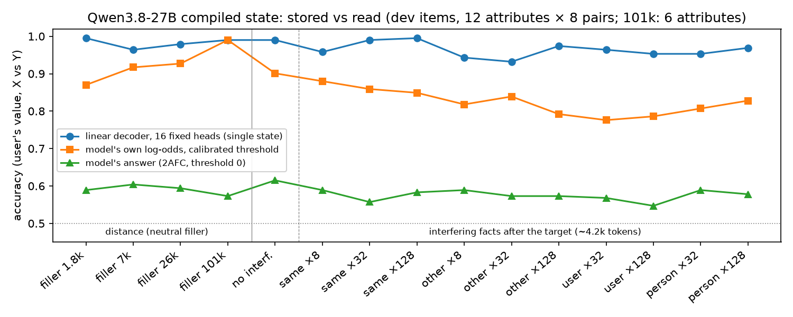
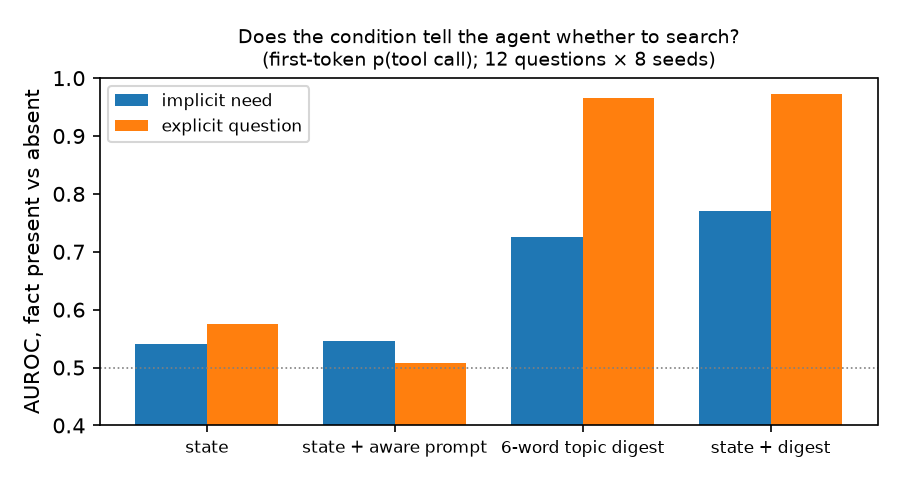
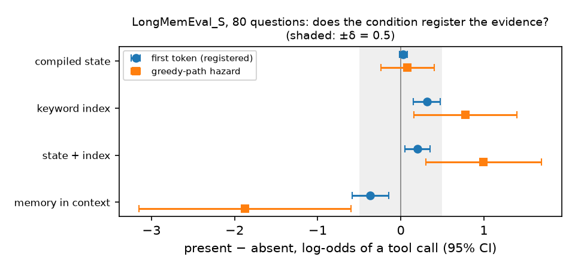
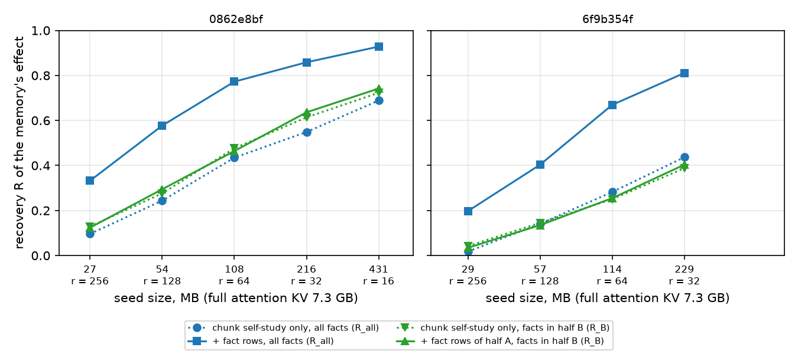
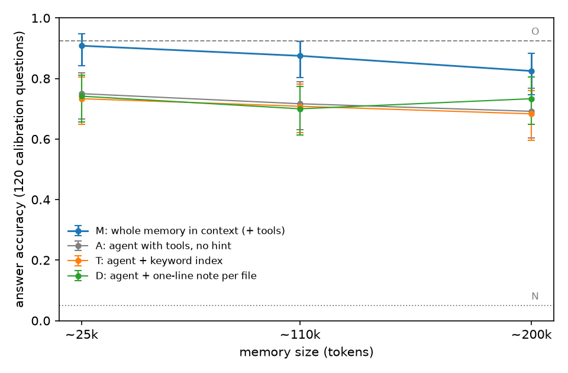

# Can seeded states carry a memory set? Compiled-memory seeds in Qwen3.8-27B

*Part 1, the GDN state: pre-registered gate G1 and hint check H1. Part 2, the attention layers:
exploratory seed development (Stage 0 and Stage 1, stopped). Part 3: a room check on answer
accuracy. Only G1 and H1 are confirmatory.*

Can one pass over a memory set produce a compact state that, seeded into an unchanged model, carries
general knowledge of that memory, so that beyond trivial memory sizes an agent seeded this way
answers better than the same agent with a text hint? Qwen3.8-27B is a hybrid with two places to
seed: 48 Gated DeltaNet (GDN) layers with a fixed-size recurrent state, and 16 attention layers
whose key–value cache (KV) grows with the memory. I first asked narrower questions of the GDN state,
then turned to the attention layers, then checked whether there is anything to win over text hints.

The question is not answered. The one compact candidate tested, the GDN state alone, holds
user-bound facts that the model reads only weakly, and it gave no cue on real histories. The
attention seed keeps much of the memory's effect on the facts it was fitted toward, but it grows
with the memory and was never scored on answers. On 120 calibration questions at ~110k tokens, the
whole memory in context beats the best text hint by 17 points, so there is room above text hints;
whether a seed reaches it was not measured.

- **1. The GDN state: stored well, read weakly.**
  - **G1 (pre-registered).** Bound facts: an effect in all 48 sealed items (0.39 nats), about 5% of
    the effect of the same text in context; the model's answer prefers the user's value in 54% of
    states (50% is chance). Preferences: 0.19, below the 0.25 smallest effect of interest.
  - **Stored well (exploratory).** A linear decoder on 16 heads recovers the user's value at
    0.93–1.00 accuracy, up to ~100k tokens and 128 interfering facts.
  - **No hint (pilot).** The state did not separate stores with the needed fact from stores without
    it in an agent's first-token tool-call log-odds; a six-word topic list did. Neither changed
    whether the agent searched, because it almost always did.
  - **H1.** On 80 LongMemEval_S questions with ~108k-token histories, swapping out the evidence
    sessions moved the first-token call log-odds by +0.03 [−0.02, +0.08]; the first tool call was
    identical in all 80. The registered verdict is INCONCLUSIVE because the controls missed the
    threshold on that measure. On exploratory measures they registered the evidence.
- **2. The attention layers: a ceiling, and a seed that isn't compact (exploratory, stopped).** At
  ~108k tokens, the memory's attention KV plus GDN state (CK) raises the gold answer's log p from
  absent store to present by +10.5 nats [5.7, 15.2], against +11.1 [6.1, 16.0] in context; the KV
  alone gives +3.8. On two development questions, a seed derived from the KV at compile time
  recovered 0.67–0.77 of the KV-plus-state effect on generated facts it was fitted toward at 64×
  compression (0.81–0.86 at 216–229 MB), and 0.26–0.46 on facts it wasn't (64×). At a fixed ratio it
  grows linearly with the memory, so it does not meet the size condition, and no seed was scored on
  answers.
- **3. Room above text hints (calibration screen, not confirmatory).** On 120 fresh LongMemEval
  questions, agents with memory tools score 0.68–0.75 at ~25k, ~110k and ~200k tokens, and text
  hints add no detectable accuracy. The whole memory in context scores 0.91, 0.88 and 0.83: +0.17
  [+0.09, +0.24] over the best text hint at ~110k (GO), and +0.09 [+0.01, +0.18] at ~200k, a GO
  resting on a single label.

## Question

Can one pass over a memory set produce a compact state that, seeded into an unchanged model, carries
general knowledge of that memory? "General knowledge" means knowledge usable for questions not known
when the state is built; the closest measure here is R_B, recovery on facts a seed's fit was not
aimed at. The test is whether, once the memory is beyond trivial size, an agent seeded this way
(with the same memory tools) answers better than the same agent with a text hint instead.

The seed must be derived from the whole memory and built before the question is known. It must be
fixed in size or clearly sublinear in the memory, and enter the model with no training, no fitted
reader, nothing fitted on test questions, and no raw or partial KV. Text hints (a keyword index, a
one-line note per file) are the baseline to beat, not a candidate.

The study took the question in three parts:
1. **The GDN state** (G1 through H1 below; pre-registered). Can a compiled GDN state stand in for
   long-term memory across sessions without training? If not, is it useful as a *hint* to an agent
   that also has its memory files? "Hint" means telling the agent that something relevant is in
   memory, or where to look.
2. **The attention layers** (Seeding the attention layers; exploratory, stopped). Where does the
   memory's effect live at ~108k tokens, and can a seed derived from the compile's attention KV
   carry it compactly?
3. **Room above text hints** (Room check; calibration screen). Beyond trivial memory sizes, does the
   whole memory in context, the most any seed could carry, beat the best text hint on answer
   accuracy?

The question in this form is the write-up's statement; the study reached it in steps. I registered
G1 on 2026-10-07 under part 1's first question, changed to the hint question that afternoon, and
registered H1 on 2026-10-08. I changed the question to the attention layers on 2026-10-10, when I
set the seed conditions, and added the answer-accuracy test against text hints on 2026-10-13. Part
3's sizes (~110k and ~200k tokens) fit in the context window. There a seed competes with loading
the memory itself, so its case is cost; beyond the window, where loading is impossible, the seed
developed here can't be built.

## Setup

Code, commands and data sources: code/README.md. Pre-registrations: PREREG.md. Literature:
LIT_REVIEW.md.

- **Model.** `Qwen/Qwen3.8-27B` in bf16 (transformers 5.12.1, fla 0.5.2 kernels) on `dgx-spark`
  (GB10); GDN state and logits in fp32; thinking off. Orchestrated with Claude Code.
- **Compile.** The memory, a system turn of dated entries ("- [2026-02-16] The user's dog is named
  Biscuit."), is prefilled once. The 48 GDN states (144 MiB) are kept; the conv buffers are reset
  and the attention cache is dropped. A later session starts from those states at position 0. An
  injection suite (`tests/check_injection.py`) checks split prefill, zero-state and greedy
  equivalence.
- **Conditions.** A: zero state. C: compiled state. M: memory text in context, as a ceiling. K: the
  memory's attention KV only, GDN state zeroed.
- **Measure.** Two memories differ only in the manipulated entry: memory X gives the user X and a
  colleague Y, memory Y swaps the roles. The shift is the change in the two values' log-odds at
  their first differing token between the two states. It needs the user–value binding; warm-start,
  format and length effects cancel.
- **Items.** Synthetic memories with templated filler, 60 to 4,000 entries (1.5k to 101k tokens): 12
  development attributes, 12 development preferences, and a sealed set of 48 fact and 48 preference
  items used only for the gate.
- **Stored vs read.** "Stored" means linearly decodable by a probe trained on labelled
  counterfactual pairs, with heads fixed on independent memories. "Read" means the model's own
  log-odds or answer moves.

## Pre-registered gate (G1)

Registered in `PREREG.md` before any 27B gate row existed. Smallest effect of interest δ = 0.25
nats; one-sided t-test and sign-flip test per block, Bonferroni over two blocks.

| Block (48 sealed items) | mean shift (nats) | 97.5% CI | items > 0 | verdict |
|---|---|---|---|---|
| B1 bound facts (role swap) | 0.387 | [0.243, 0.532] | 48/48 | PASS |
| B2 preferences ("loves t" vs "can't stand t") | 0.185 | [0.112, 0.258] | 39/48 | below δ, not killed |

- **Harm (K2): passed.** On 40 unrelated questions the harm ratio was −0.048 (90% CI −0.076 to
  −0.022), and none of 480 question × memory cells flipped from gold to distractor.
- **Size.** The answer prefers the right value in 54% of bound-fact states. In bounded probability
  units the state delivers 5.0% [3.4, 6.6] of the in-context effect for bound facts and 6.1% for
  preferences.
- **Exploratory, after unblinding.** On the 34 preference items where the text in context moves more
  than 1 nat, the state's shift is 0.258 [0.18, 0.34], so B2's miss is partly a weak probe. This does
  not change B2's registered outcome.
- **Where in-context recall comes from.** The memory's attention KV alone gives 19.3 nats on
  single-mention facts, against 30.0 for the full context and 1.0 for the state.
- **Gist, not items.** On word lists, the state pulls toward associated words never in the list
  (0.27 Yes−No log-odds, 8 of 8 lists) but barely separates listed words from those lures (0.05).
  With the text in context: pull 2.9, separation 11.7.

## Storage vs readout (exploratory, development items)

**Retention does not predict what is readable.** Only 0.7% of heads keep more than half of a write
after 4,096 tokens, which predicts strong recency. Yet the first entry gives about 2× the shift of
the last on the 4B pilot, and first − last is +0.52 nats on sealed 27B items.

**Storage.** A difference-of-means decoder on per-head Gram matrices of the fp32 states, trained on
15 counterfactual pairs and tested on the 16th, reaches 0.99 single-state accuracy with 16 heads on
1.5k-token memories, against the model's 0.84. Heads chosen on other attributes give 0.97–0.99;
label-swap nulls average 0.50. My first all-heads probe scored 0.75–0.81, and I wrongly read that as
"nothing stored". The per-head selection is logged as post hoc.

**Capacity and interference** (fixed heads, new memories; Figure 1). With up to 4,000 neutral
entries after the facts (101k tokens), the decoder stays at 0.96–0.995 and the model's push stays
flat at 0.72–0.97 nats. With 8–128 interfering facts, the decoder stays at 0.93–1.00; from 32
interferers on, the model's push falls to 0.63–0.86 of its no-interference value. There is no cliff
from 8 to 128. I had predicted that same-attribute interference would erase the binding. It did not.

*Figure 1. Single-state accuracy for the user's value. Blue: decoder on 16 heads chosen on
independent memories. Orange: model log-odds, threshold calibrated per attribute. Green: the model's
actual preference (threshold 0). 12 attributes × 8 pairs per point (6 at 101k).*

**Why the answer rarely changes.** The push is consistent (0.78–0.99 accuracy with a calibrated
threshold) but only 0.5–1 nat, against a typical prior gap of about 2 nats.

**Gain.** Uniform ×2 amplification raises the bound-fact shift from 0.80 to 2.58 nats and the 2AFC
(two-alternative forced-choice accuracy) from 0.58 to 0.67, but multiplies lure familiarity (0.24 →
1.40) and adds a recency pull. The decoder's top 64 heads at ×4 raise the shift 1.66× without
either, beating 64 random heads at ×4 by +0.51 nats [+0.19, +0.83], but the 2AFC does not move
(0.57 vs 0.58). The
model reads those heads as "this value is familiar", not as "this is the user's value".

## Hint vs access (exploratory pilot)

**Design.** Three memory tools (list, search, read) over stores of 60 entries. Twelve
*implicit-need* questions ("Suggest one dinner idea for tonight." with "The user is vegetarian." in
memory) and twelve *explicit* ones ("What is my dog's name?"), each against two same-size stores
that differ only in the needed fact, over 8 seeds. I scored log p(tool call) at the first token and
a greedy first action (2,160 sessions).

**Results.**
- **No "this is in memory" signal.** Present vs absent: first-token AUROC (area under the ROC curve)
  0.54 (implicit) and 0.58 (explicit); greedy call rate −0.01 [−0.03, +0.01] and 0.00; 0.55 and 0.51
  with a prompt describing the state. A six-word topic list gives 0.73 and 0.97 (Figure 2). Adding
  the state to it adds nothing.
- **No reduction in searching.** The state lowers the first-token call logit by 1.2–1.8, mostly
  through a preamble before the call. Greedy call rates do not differ (−0.11 [−0.28, +0.06]), and a
  state compiled from filler does the same.
- **The stored value never appears** in what the agent writes or searches for (0 of 528 checkable
  sessions).
- **Near saturation.** The agent searches for 9–10 of 12 implicit-need and all 12 explicit questions
  in every condition but full context. Even the topic list changes *what* it searches for, not
  *whether*.

*Figure 2. Within-question AUROC of the first-token tool-call log-odds, fact present vs absent; 12
questions × 8 seeds per family.*

## Hint check on LongMemEval_S (pre-registered, H1)

This tests the pilot's finding on real histories, scoring the first action only. It was registered
in `PREREG.md` §H1 before any sample question was run, and the analysis ran unmodified.

**Design.** LongMemEval_S, cleaned release [wu2025longmemeval]: 80 questions drawn with seed 42 from
a frame of 278 (24 single-session-user (SSU), 24 single-session-preference, 16 knowledge-update
(KU), 16 multi-session (MS)). Each history is a store of ~50 files (one per session, about 108k
tokens). *Absent* replaces each evidence session in place with a length-matched personal session
from another history that contains neither the gold answer nor the question's content words.
Conditions: A, C and M; S, a donor state from another history; T, a keyword index in the prompt (the
top 8 words per file by term frequency–inverse document frequency, ~1.7k tokens); CT, state plus
index. The primary is Δ_C = L(C, present) − L(C, absent), with L the first-token log-odds of a tool
call and δ = 0.5 logits. A NULL also needed a control (T or M) to register presence at δ on the same
measure.

**Results.**
- **The state does not register the evidence.** Δ_C = +0.030 [−0.017, +0.077] bounded within ±0.08
  logits, a sixth of δ. It is no larger than a placebo swap of an unrelated session (+0.02 [−0.03,
  +0.08]), and no question type differs. On the greedy-path hazard it is +0.08 [−0.24, +0.40]. Under
  C the greedy first action, tool and query, is identical for present and absent in all 80 questions
  (49 of 80 with the index, 30 with the memory in context).
- **The controls register it, but below δ at the first token.** T +0.31 [+0.15, +0.47]; M −0.37
  [−0.59, −0.15]. Both are non-zero after Holm correction but below δ, so the verdict is
  **INCONCLUSIVE (no control registered presence)**. Exploratory, after unblinding: on the
  greedy-path hazard the controls clear δ (T +0.78, CT +1.00, M −1.87). With the present store's
  index the first action reads a file in 12 questions, each time the evidence file, against 1 with
  the absent index;
  with the memory in context the agent answers instead of searching (24 vs 6 discordant pairs).
  Tying the control to the first-token measure was my design error.
- **No readable trace of the answer.** Gold-answer log-likelihood with no tools (SSU and KU, n =
  38), present − absent: +0.015 nats [−0.06, +0.09] under C, +10.7 [8.9, 12.5] under M.
- **Where to look is easy here.** The agent calls a tool in 95–99% of sessions under A, S and C, and
  its first search ranks an evidence file in the top 3 (BM25) for 94–100% of questions in every
  condition.

*Figure 3. Present − absent tool-call log-odds per condition, 80 questions, 95% t-intervals.
Circles: first token (registered). Squares: greedy-path hazard (exploratory for the controls).
Shaded: ±δ.*

## Seeding the attention layers (Stage 0 and Stage 1 development; exploratory)

Nothing here is pre-registered or confirmatory. I logged a reading rule in the contemporaneous log
(`results/audit/LABNOTES_full.md`) before each run except dev run 1, a pipeline check. Three rules changed after their run had started: Stage 0's
after I had seen its results, dev run 6's before any item score existed, and dev run 8's 18 minutes
after launch, before any present-store output existed.

**Why the question changed (part 2).** The untrained model does not read the GDN state as a "look
here" cue. A keyword index does register the evidence's presence in the call decision, though
below H1's registered threshold. The 16 attention layers are the other place to seed, so from here
the candidate is the compiled GDN state plus a seed in every attention layer, both from one compile
pass. The attention seed must come from the whole memory's KV, not a subset of raw entries, and
meet the other conditions listed under Question.

**Stage 0** (no compression; 16 development questions from H1's frame, excluding H1's; 104.8k–111.4k
tokens; anchor = Σ log p of the gold answer, on the 9 with a short gold). CK is the memory's
attention KV plus the compiled GDN state.
- **Content shows up only when KV and state are loaded together.** Present − absent: CK +10.5 nats
  [5.7, 15.2], M +11.1 [6.1, 16.0]. K alone gives +3.8 [0.6, 6.9], C alone −0.18 [−0.45, +0.08].
  Both single-part conditions are off-distribution, so "K < CK" may mean the mismatch breaks
  retrieval, not that the state holds the content.
- **Positions can be collapsed for content.** Un-rotating every key to position 0, with the session
  4,096 positions later (K\*), loses no anchor content (K\* − K +0.58 [+0.14, +1.03], n = 9), but
  the first action loses its sensitivity to presence.
- My Stage 0 rule gave no verdict. By an amendment made after seeing the data, CK became the
  ceiling; the seed's own is **CK\***, CK with un-rotated keys and the session at 65,536.

**The seed** (`statelm/kvseed.py`). For T memory tokens and ratio r, each of the 64 attention KV
heads gets N = T / r entries, derived at compile time from the memory's own KV. **Keys** are k-means
centroids of the un-rotated keys, at position 0; from dev run 7, the k-means weights each memory key
by the attention mass the reference queries put on it (**mass keys**). A per-entry logit **bias**
matches the full memory's attention mass, and ridge-fitted **values** match its attention output,
both at the reference queries. These come from the memory, never the test question:
- **sst**, chunk self-study [eyuboglu2026cartridges, zweiger2026fast]: the model writes a question
  for each 384-token chunk without the memory, then answers it under CK\*.
- **ssf**, fact-level self-study: a memory-free generator writes a question for each fact the user
  states, and the queries predicting its answer under CK\* get a set share of the fit weight
  (**ssfd** weights tokens by the memory's effect). Fitting half A of the sessions' facts leaves
  half B as facts the fit isn't aimed at.
- **probe**: CK\*'s queries at the test question. In sample; a ceiling, not a method.

At T ≈ 111k and r = 64, N = 1,740 per head: 114 MB, against 7.3 GB for the full KV.

**Measures.** 'L', the first token of "Luna" on 0862e8bf, is the one clean anchor token (−11.15
under C, −0.00 under CK\*). R = Σ (lp_seed − lp_C) / Σ (lp_CK\* − lp_C) (lp: log p) over generated
fact items: R_all over all of them, R_B over half B's.

**Dev runs 1–8** (T ≈ 105k–111k; runs 3–8 on 0862e8bf and 6f9b354f).

| run | r | change | result |
|---|---|---|---|
| 1 | 16–256 | fitted seed, 6f9b354f | Summed anchor, present − absent: CK\* +21.5; r = 64 +4.1 |
| 2 | 16, 64 | reference queries; adds 0e4e4c46 | Self-study matched probe's error only where a chunk fell in the evidence session |
| 3 | 64 | sst, every chunk | summed 'Luna' anchor −8.65, probe −0.04 (C −11.3) |
| 4 | 64 | sst + probe rows | 'L' −9.39 → −0.48 with probe rows at 10.7% of fit weight |
| 5 | 64 | bias-only | 'L' lost (−8.97 to −9.84): the values carry the lookup |
| 6 | 64 | ssf 30%, k-means keys | R_all +0.141 and +0.146, below my +0.2 bar; half A doesn't raise R_B |
| 7 | 64 | mass keys | R_all +0.395, to 0.77 and 0.67; R_B 0.46 and 0.26, what sst alone gives |
| 8 | 256–16 | seed size; leak check | below and Figure 4 |

I later corrected three readings of runs 1–3: the summed anchor on 6f9b354f is mostly 'a' and
'lighter', not 'gray'; run 1's content at r = 16 came from the unfitted construction; and self-study
had counted one block of system-prompt queries hundreds of times (an estimated 29–35% of sst's
rows), which drove run 2's choice. The fact generator covers 9/9 gold facts but anticipates the test
question: two verbatim, the rest at word overlap 0.54–0.90.

- **Size** (dev run 8). The 30% fit recovers 0.33 and 0.20 at r = 256, 0.86 and 0.81 at r = 32 (216
  and 229 MB), and 0.93 at r = 16 (431 MB) on 0862e8bf; on 6f9b354f that fit ran the machine out of
  memory. R_B of the half-A fit (facts the fit isn't aimed at) rises from 0.12 and 0.03 at r = 256 to
  0.64 and 0.40 at r = 32. At r = 256, 'L' is
  −8.5 to −9.4.
- **No leak.** Rebuilt without the evidence sessions, seeds keep 'L' below that memory's own
  uncompressed ceiling, and the gains repeat (+0.134 and +0.152 in dev run 6; +0.33 and +0.39 for
  the fact rows in dev run 8).
- **Anticipation.** 'L' reaches −0.05 under chunk self-study alone with mass keys, but one
  self-study question names the cat.
- **A gate that could barely pass.** I required the fact rows to add 0.5 over chunk self-study.
  Their room, about 1 − R_all(sst), shrinks as the seed grows; they stayed below the bar at every
  size, and on 0862e8bf it was out of reach at r = 32 and 16.

*Figure 4. Recovery R against seed size, two development questions (dev run 8; one fit per point).
Blue, all items; green, half B's. Dotted: chunk self-study only. Solid: plus fact rows at 30% of the
fit weight (blue, in sample) or from half A (green). The full KV is 7.3 GB.*

**Why I stopped.** On 2026-10-13 I stopped Stage 1 to review every gate against the question. A
review checklist, executed once with Claude Code agents, found that nearly every decision gate had a
flaw, most often a proxy measure standing in for the question or a threshold I hadn't derived. The
validity checks worked. No seed run had scored answer accuracy or faced a text-hint agent. And
the seed is fitted against the full KV, so it cannot be built beyond the context window, where
loading the memory is impossible and a seed would have to win. Dev runs 9 and 10 were planned and dropped, because they could not bear on
the question even if they passed.

## Room check: is there room above text hints? (answer accuracy, calibration questions)

Part 3 of the question: beyond trivial memory sizes, does a model with its whole memory to
hand (the most any seed could carry) beat an agent with the best text hint? If not,
no seed can show an advantage there.

**Setup.** I logged the rule before any question ran and amended it once, with three changes,
also before any question ran. How the items reached the second judge changed after the runs,
before any label.
- **Questions.** 120 fresh LongMemEval questions, stratified by type (SSU 11,
  single-session-assistant 19, MS 32, temporal-reasoning 42, KU 16; abstention excluded). The other
  242 fresh questions are held out. Dropping six with known answer errors and one that H1's smoke
  test ran leaves 235 test questions, none of them ever run. One calibration question ran once in
  H1's plumbing smoke.
- **Stores.** Each question's LongMemEval_M sessions, one file per session, nested: evidence only
  (O) ⊂ ~25k ⊂ ~110k ⊂ ~200k tokens.
- **Model.** Qwen3.8-27B on SGLang, greedy, thinking off. Agents have search (BM25 over lines, top
  10, 300-character snippets), read and list tools, and stop by themselves, at most 8 calls.
- **Arms.** N: no memory, no tools. A: tools, no hint. T: tools + a keyword index. D: tools + a
  one-line note per file, written question-blind by the same model. M: the whole memory in context,
  plus tools. O: the evidence sessions in context, plus tools.
- **Judges.** Qwen judged every answer with LongMemEval's answer check. A second judge, eight Claude
  Opus 5.5 agents blind to the arm (instructions in `code/experiments/room_judge2_prompt.md`),
  labelled the 480 answers that enter the decision; its labels are final.
  Flip reruns of T and M at 25k gave the noise term.
- **Rule.** At ~110k and ~200k: G = acc(M) − acc(B\*), where B\* is the stronger of T and D. D_min =
  √(7.84 q / (235 + 7.84)), the smallest gain the 235 held-out questions could detect at the
  observed discordance q. GO if G's lower bound is above 0 and G ≥ D_min. NO-GO if G's upper bound
  is below D_min.

| arm | ~25k | ~110k | ~200k |
|---|---|---|---|
| N: no memory | 0.05 | | |
| O: evidence only, in context | 0.93 | | |
| M: whole memory, in context | 0.91 | 0.88 | 0.83 |
| A: agent, no hint | 0.75 | 0.72 | 0.69 |
| T: agent + keyword index | 0.73 | 0.71 | 0.68 |
| D: agent + note per file | 0.74 | 0.70 | 0.73 |

M at ~110k and ~200k, T at ~110k and D at ~200k use the second judge's labels; the other cells use
Qwen's. On Qwen's labels alone, M at ~200k is 0.80 and T at ~110k is 0.72.

*Figure 5. Answer accuracy against memory size, 120 calibration questions, Wilson 95% intervals per
arm. The decision uses paired differences, which are much tighter. O and N are size-free
references.*

- **Text hints add no detectable accuracy over the bare agent.** B\* − A is −0.01 [−0.08, +0.07],
  −0.01 [−0.07, +0.06] and +0.04 [−0.04, +0.13] (paired bootstrap; `results/phase2/room/hint_gain.txt`).
  B\* is the better hint, picked after the fact, which favours the hints. Plain search usually finds
  the evidence, as in H1.
- **Both the agents and the context lose a few points with size.** From 25k to 200k (8× the
  memory), A loses 6 points, T and D lose 1–5, and M loses 8 (11 on Qwen's labels). With the question
  itself as the query, BM25 puts an evidence file in the top 3 for 92% of questions at 200k, but all
  evidence files in the top 10 for only 82% (98% at 25k; `results/phase2/room/bm25_check.txt`).
- **Verdict: GO.**

  | | G = M − B\* [95%] | D_min | call | f\* |
  |---|---|---|---|---|
  | ~110k | +0.167 [+0.092, +0.242] | 0.080 | GO | 0.45 |
  | ~200k | +0.092 [+0.008, +0.175] | 0.085 | GO | 0.95 |

  - **~110k** is GO under either judge. M is right where B\* is wrong on 22 questions, and the
    reverse on 2. Of the 22, 13 are multi-session.
  - **~200k** is GO by 0.006. On Qwen's labels alone it is INCONCLUSIVE (+0.067 [−0.008, +0.150]),
    and flipping any one of the 19 questions where M is right and B\* wrong removes the GO. I read it as "some room at
    200k, and not much".
  - f\*, which the rule reports on GO, is (B\* − A + D_min) / (M − A): the room above B\* as a
    share of the gap from the bare agent to M. It is 0.45 at ~110k and 0.95 at ~200k.
- **Where the room is.** Mostly in multi-session questions: agents 0.41–0.59, M 0.72–0.91, O 0.94.
  Replaying the agents' calls, half of the agents' wrong answers had seen every evidence file (in a
  snippet or a read) and still answered wrong; the other half missed at least one. The gap is part
  finding and part using: a 300-character snippet doesn't carry every fact, and agents stop reading
  early.
- **Noise and judges.** The reruns changed 0 of 80 labels. The two judges agree on 468 of 480; the
  disagreements are borderline either way (hedged answers, an off-by-one day count, "approaching
  1,300").

**What GO means.** Room above text hints is necessary for a yes to the question, not sufficient. It says
nothing about whether a derived seed captures any of that room, and no seed has been run against it.

## Limitations

- Only G1 and H1 are confirmatory. Everything else uses development items, was designed after seeing
  earlier results, and is a single exploratory pass. The development binding effect (0.80 nats) is
  about twice the sealed one (0.39).
- Except in H1, Stage 0/1 (LongMemEval_S histories) and the room check (LongMemEval_M sessions),
  memories are synthetic and templated. H1 used real histories only for first actions and a
  gold-likelihood anchor; the room check has no state or seed arm.
- One model (4B results are pilots). "Stored" shows that unused information is present, not that the
  model could use it without training.
- The conv buffer was reset by design; keeping it gave a larger shift than the whole recurrent state
  (3.9 vs 1.7 nats), so C is a stricter test than some prior split-prefill work.
- The hint pilot and H1 score first actions only: no agent loop, answer accuracy, read budget or
  turns that need no memory. Near saturation, neither can show a hint that saves reads.
- H1's absent stores remove the question's topic, the easiest case, and the evidence that its
  controls work on measures other than the first token is exploratory.
- LongMemEval questions share vocabulary with their evidence, and LongMemEval_M's filler is mostly
  unrelated, so search is easy. Vocabulary mismatch or implicit need would test access and hints
  harder.
- **Seeding is exploratory development**, with rules amended after launch and CK chosen as the
  ceiling after seeing the data. Stage 1 rests on two questions (plus 0e4e4c46 in dev run 2) and one
  clean token; R covers a few hundred generated facts per memory, clustered in about 30 sessions.
  Every choice was made on the questions it is scored on, so the readings are optimistic.
- **Much of Stage 1 is in sample.** The probe sets use test-time queries; the generator and one
  chunk self-study question anticipated the test questions; chunk self-study used the test session's
  date and templates. Only R_B speaks to generalisation: fact rows from half A didn't raise it, and
  mass keys raised it through chunk self-study (+0.19 and +0.11).
- **The seed is scored by log-probs, not answer accuracy,** mostly on the present store. At fixed r
  it grows linearly with the memory, and only one length was tested, so the fixed-size-or-sublinear
  condition is not met.
- **The room check is a calibration screen, not a confirmatory test.** It ran on 120 calibration
  questions; the 235 test questions were set aside and never run. It used one model and one agent design; a
  stronger agent with longer snippets or more reading could close part of the gap. The ceiling arm M
  also has tools, and up to the window (~240k tokens here) it is a usable system in its own right.
- **Qwen3.8-27B judged its own answers.** Only the 480 decision answers have a second judge (Claude
  agents; 468 of 480 agree). The 25k cells, A everywhere, T at ~200k and D at ~110k rest on
  self-judging, and no human audit was run.

## Verdict

**The question is not answered.** The one compact candidate tested, the GDN state alone, gives the
model little it uses. No attention seed that meets the size condition was built, and no seed was
scored on answers. What the study shows, part by part:

**1. The GDN state.** For Qwen3.8-27B without training, a compiled GDN state is a faithful store
and a weak, unspecific cue:
- user-bound content is present and survives distance and interference at the tested scales;
- the model reads it as familiarity worth about 5% of the text;
- it does not tell an agent with memory tools whether to look, in synthetic stores or in real
  ~108k-token LongMemEval_S histories, where it also carries no readable trace of the answer.

At these scales the limit is readout, not storage. Larger state stores would solve a capacity
problem this study did not find. A short text index registers the evidence's presence in the
agent's call decision, which the state does not.

**2. The attention layers (development, not a verdict).** At ~108k tokens, the memory's content
showed up when the attention KV and the GDN state were loaded together, and much less with either
alone, though both single-part conditions are off-distribution. A seed derived at compile time, 64×
smaller than the KV, carried the answer on one development question when fitted in sample. Fitted
from the memory alone, it reached 0.67–0.77 of the KV-plus-state effect on the generated facts it
was fitted toward once its keys went where the self-study's attention lands, not where k-means put
them, and 0.81–0.86 at 3% of the KV. Facts the fit isn't aimed at get only what chunk self-study
gives them, so the seed depends on the generator anticipating what will be asked, or on being
large. At a fixed ratio the seed grows linearly with the memory and can't be built beyond the
context window, so it is not compact in the question's sense. Whether it yields better answers than
a text-hint agent is untested.

**3. Room above text hints (answer accuracy, calibration questions).** Text hints add no detectable
accuracy over an agent with memory tools at ~25k, ~110k or ~200k tokens (every 95% interval for the
difference spans 0), and on LongMemEval_S plain search already finds the evidence on the first
query. The bare agent scores 0.75, 0.72 and 0.69 across the sizes; search usually finds an evidence
file, and about half its errors come after seeing every evidence file. The whole memory in context
does better: by 17 points at ~110k (GO), and by 9 at ~200k (GO by one label), mostly on questions
that combine several sessions. So on these calibration questions there is room above text hints for
a memory representation that carries what the context carries. Both sizes fit in the context
window, where loading the memory is itself an option, and no seed was run against the room.
