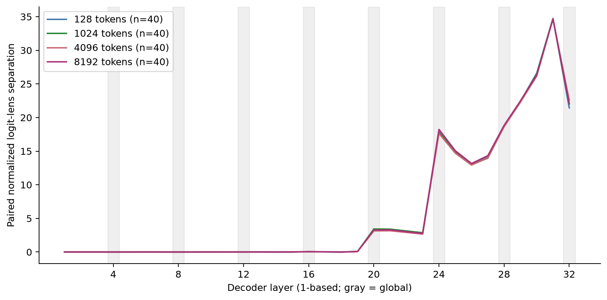
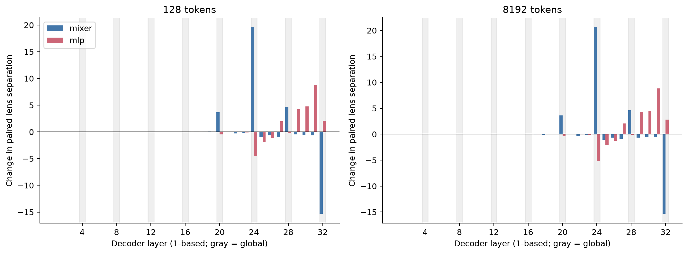
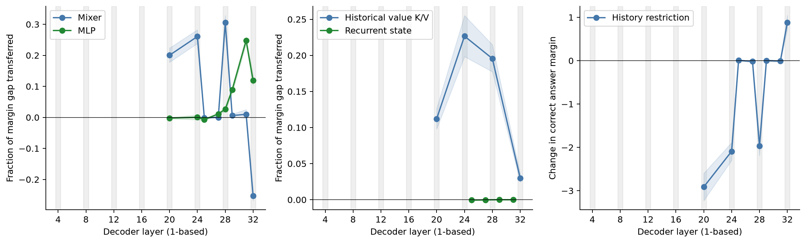
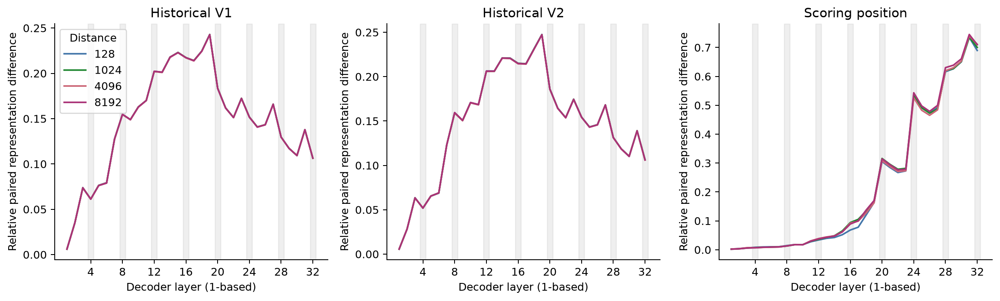

# Retrieval and prediction changes in a frozen hybrid model

**Date:** 2026-10-13 to 2026-10-14 · **Machine:** `local-3090` · **Model:** Qwen3.5-4B

The fresh-example runs support a stronger historical-value K/V route through the selected global-attention layers than a recurrent-state route at the tested checkpoint. They also show a substantial query MLP contribution inside a recurrent block. This distinguishes the mixer mechanism from the contribution of an entire decoder block.

## Object and method

I used the frozen post-trained [Qwen3.5-4B checkpoint](https://huggingface.co/Qwen/Qwen3.5-4B) at revision `851bf6e806efd8d0a36b00ddf55e13ccb7b8cd0a`. Its [text configuration](https://huggingface.co/Qwen/Qwen3.5-4B/blob/851bf6e806efd8d0a36b00ddf55e13ccb7b8cd0a/config.json) has 32 decoder blocks: three Gated DeltaNet blocks followed by a global-attention block, repeated eight times. Every block also contains an MLP. Weights were BF16; no training or quantization was used.

The MIT-licensed [FactWorld](https://github.com/ianbarber/factworld) world, renderer, and symbolic oracle supplied the facts and labels. Each example had sixteen distractor facts and a pair of target facts. Execution B swapped the two historical keys from execution A. Both historical values kept their identity and positions, and the query and all other tokens stayed fixed. The target facts preceded neutral filler. Their order was counterbalanced. The older value's last token was exactly 128, 1,024, 4,096, or 8,192 tokens from the scoring position; the other source was fourteen tokens nearer. Both actual distances are retained in the evidence.

Full-answer accuracy came from unconditioned greedy generation with thinking disabled. Because identifiers such as `v730` and `v775` share initial tokens, the mechanistic score supplied only the shared answer prefix and compared the first differing token: after `v7`, compare `3` with `7`. This is a conditional margin measurement, separate from full-answer recall. All fresh generations had valid value-only format.

The exploratory pilot used data seed 20261014, twenty examples at all four distances, and causal patches on three underlying examples. It selected global layers **20, 24, 28, 32** and recurrent layers **25, 27, 29, 31**, using paired mixer logit-lens changes. I froze that selection before the expansion: fresh data seeds **42 and 314159**, twenty examples each, reused across all four distances. Both full answers and both first-differing-token predictions had to be correct for causal eligibility. All 160 fresh paired cases qualified.

I captured source and scoring-position residuals and separated mixer from MLP updates. The logit lens applies the model's final normalization. Source representation differences are Euclidean paired distances divided by the mean of the two residual norms. At each selected layer I exchanged the query residual, mixer output, or MLP output between executions. At a checkpoint before the final **64 tokens**, I separately exchanged a recurrent state or the K/V entries for both complete historical value spans. Sources were outside that recent window. Recurrent states were FP32; each intervention used a fresh cache copy and its matching unchanged cached baseline. History restriction cleared recurrent and convolution states, or masked global prefix K/V access, at one layer.

A transfer fraction of zero leaves the recipient's clean paired-logit margin unchanged; one reaches the donor's clean margin. It is a margin fraction, not an answer probability. Both directions were averaged within an example. Intervals use 10,000 bootstrap draws of whole `(data seed, example)` clusters, retaining dependent directions and distances together.

## Fixed expansion results

All **320/320** fresh full answers were correct: 80 answers and 40 both-correct pairs at each distance. The model reliably performed this controlled recall task throughout the tested range. This accuracy measures sparse facts followed by neutral text, rather than retrieval through dense competing facts.

The locked primary endpoint at 8K averaged the four selected global value-K/V transfers and subtracted the corresponding average over the four selected recurrent-state transfers. The secondary endpoint was query MLP transfer at layer 31. Support required a mean of at least 0.05 and a 95% interval lower bound above zero. These criteria and the accuracy/stop gates were recorded before the fresh runs.

| Data seed | Underlying examples | Global K/V minus recurrent state, mean [95% interval] | Layer-31 MLP, mean [95% interval] |
|---|---:|---:|---:|
| 42 | 20 | 0.140 [0.124, 0.155] | 0.244 [0.228, 0.260] |
| 314159 | 20 | 0.143 [0.128, 0.158] | 0.251 [0.238, 0.266] |
| Pooled | 40 | **0.141 [0.130, 0.152]** | **0.248 [0.237, 0.259]** |

Both criteria were met in each seed and in the pooled result. At 8K, mean global K/V transfer was **0.141 [0.130, 0.152]**; mean recurrent-state transfer was **-0.0002 [-0.0007, 0.0003]**. There were no small-denominator exclusions. The exploratory pilot is retained separately and is excluded from these pooled estimates.

The large paired prediction changes appeared at global-attention blocks, with additional late changes from MLPs. Whole-block attribution would obscure that distinction. In particular, the layer-31 MLP had a substantial effect even though the selected recurrent-state exchanges had little effect. The final global mixer could move the pair contrast in the opposite direction, so global layers did not all amplify this margin.

The component interventions below use the fixed eight candidates at **8K**, with forty underlying examples. The history panel reports correct-answer margin changes: negative values indicate impairment. Clearing selected recurrent histories had small effects; masking prefix access at several selected global layers reduced the margin. These interventions concern a measured prediction contrast, not a demonstrated flip of every full generated answer.

Historical value representations became sensitive to the key swap early in the stack. This is consistent with local association-building before later retrieval, but the representation-distance trace alone does not prove that an individual early transformation is necessary.

## Limitations

This is one pretrained checkpoint and one controlled distribution: three-digit identifiers, sixteen distractors, target facts grouped before neutral filler, and a query at the end. The same forty examples recur across distances. It is not a capacity-matched comparison: one recurrent state has a fixed budget, whereas a global layer retains per-token K/V. Candidate selection came from the pilot; only the selected layers and one 64-token cutoff were causally examined.

A restriction at one layer leaves other layers able to carry or retrieve older information. Conditional first-difference margins do not substitute for a test of arbitrary full-generation behavior. Logit-lens and source-distance curves are descriptive; the donor exchanges and history restrictions support narrower causal statements. The experiment does not identify a universal recurrent-memory horizon, a sliding-window comparison, or an optimal layer ordering.

## Verdict

For this frozen hybrid and this recall distribution, the fixed fresh-example tests support stronger historical value-K/V contribution at the selected global layers and a substantial late MLP contribution within a recurrent block. Recurrent-state exchange at the tested checkpoint contributed little to the paired answer contrast. The result is a functional account of these measured components; the architecture-wide capacity and ordering questions remain outside the evidence.

The [analysis](results/analysis.json), [compact measurements](results/), and [reproduction commands](code/README.md) expose the sample sizes, seed-specific estimates, and all selected-layer effects. Execution-path qualification and failures are recorded in the [lab notes](LABNOTES.md).
