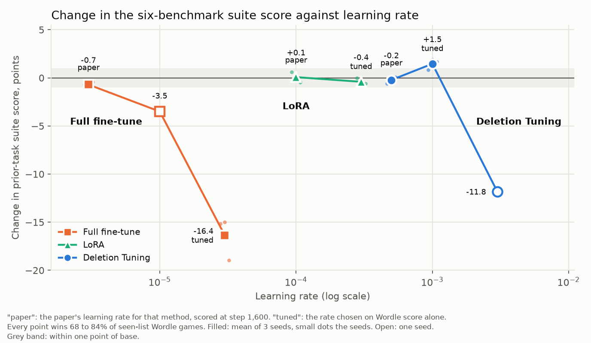

# Deletion Tuning on LFM3-1.7B: learning Wordle by zeroing weights, and what gets forgotten

**Date:** 2026-11-16 · **Machine:** `worker-b` (one RTX 5090, 32 GB)

## Brief

Lu et al. (arXiv 2611.10866) report that an LLM can be post-trained by learning only which
weights to zero ("Deletion Tuning"), that this matches full fine-tuning, and that it forgets
far less of what the model already knew. Their retention result is for reinforcement
learning. I test both claims under supervised fine-tuning on `LiquidAI/LFM3-1.7B`, with a
Wordle tool-calling dataset (`openenv/wordle-tool-calls-sft`) as the new task, against full
fine-tuning and LoRA. Forgetting is measured on the paper's six-benchmark suite (HellaSwag,
MMLU, TruthfulQA, WinoGrande, IFEval, HumanEval), on three seeds, at the paper's learning
rates and at rates tuned on Wordle score.

## Headline results

- **Deleting weights learns the task as well as full fine-tuning.** Base wins 0 of 156
  games. At the paper's learning rates after 1,600 steps, Deletion Tuning wins 81% of
  seen-list games, full fine-tuning 69%, LoRA 68% (three seeds). Deletion Tuning is at or
  above full fine-tuning on every seed, but three seeds do not establish the gap (-5 to +29
  points).
- **At the paper's learning rates, nothing is forgotten.** Suite change from base: full
  fine-tuning -0.7, LoRA +0.1, Deletion Tuning -0.2, each within a point on three seeds. So
  whether deletion forgets less could not be tested: there was no forgetting to avoid.
- **Forgetting is set by the learning rate, not the method.** Full fine-tuning at ten times
  the paper's rate loses 16.4 suite points and answers ordinary prompts with Wordle moves.
  Deletion Tuning at six times loses 11.8. Both win the same share of Wordle games as
  before, at the same validation loss, so tuning on the new task alone gives no warning. The
  pre-registered comparison used rates tuned that way and reads as a 17.8-point win for
  deletion. That is a learning-rate contrast.
- **One small difference between methods:** Deletion Tuning is about a point above LoRA on
  the four multiple-choice benchmarks (+0.8 at the paper's rates, +1.4 at the tuned ones,
  same sign on every seed).
- **The mask is megabytes, but not as sparse as the paper's.** 3.3 to 5.8 MB with 0.14 to
  0.30% of all weights zeroed (paper: under 0.05%). A rank-1 LoRA is 4.2 MB.
- **Most of the mask is learned, but which weights go is close to arbitrary.** 79 to 91% of
  the deployed deletions were made in training, and the ones inherited from the starting
  mask can be put back at no cost. Which weights are deleted follows the random starting
  noise: two seeds reach the same score sharing 6% of their deletions, while agreeing on
  which blocks and residual dimensions to thin.
- **Cost.** Deletion Tuning trains at LoRA's speed (0.33 s a step, LoRA 0.35, full
  fine-tuning 0.38) in 15.9 GiB of GPU memory (LoRA 10.2, full fine-tuning 26.9). At the
  paper's rates it wins 70% of seen-list games by step 400, where full fine-tuning is at 57%
  and LoRA at 41%.
- **Nobody learned Wordle.** The dataset's 156 secret words all recur in training. On words
  that never appear there, every method stays under 5%.

*Change in the six-benchmark suite score against learning rate, the three methods on one
axis. "paper" marks the paper's SFT rate for that method and "tuned" the rate chosen on
Wordle score alone. Filled markers are means of three seeds with the seeds as small dots;
open markers are one seed. Every point wins 68 to 84% of seen-list Wordle games. Look at the
three "paper" points inside the grey band, and at how far the same method falls at a higher
rate.*

## Contents

| File | What it is |
|---|---|
| [`REPORT.md`](REPORT.md) | Method, results, limitations, verdict |
| [`PROTOCOL.md`](PROTOCOL.md) | The pre-registration and its twelve amendments |
| [`LABNOTES.md`](LABNOTES.md) | The run as it happened, failures included |
| [`code/`](code/) | Simulator, the three tuning methods, evaluation, analysis; [`code/README.md`](code/README.md) has the commands |
| [`results/`](results/) | `final.json` (endpoints and both kinds of interval), `grid.json` (tuning), `lr_diagnostic.json`, `ifeval_behaviour.json`, `humaneval_reading.json`, `mask_anatomy.json` (what the masks contain), `cost.json` (training time and memory), gate outputs, and `evidence.tar.gz` (per-item scores and game outcomes for every scored checkpoint) |
| [`results/audit/`](results/audit/) | Harness history, per-run tables, and the list from a project-agent review of the entry |
| [`images/`](images/) | Figures, including the kickoff sketches |
