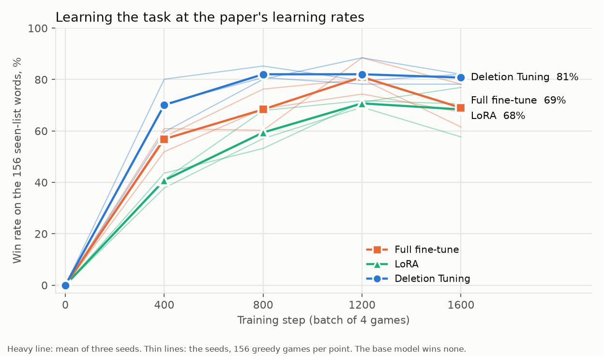
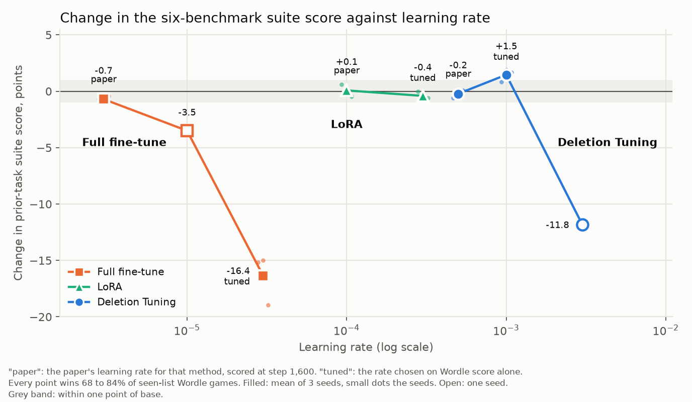
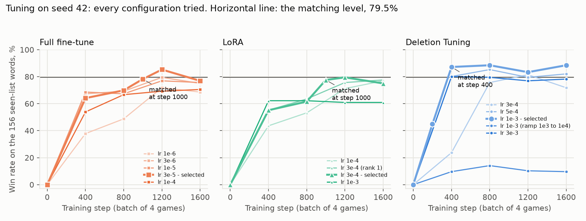
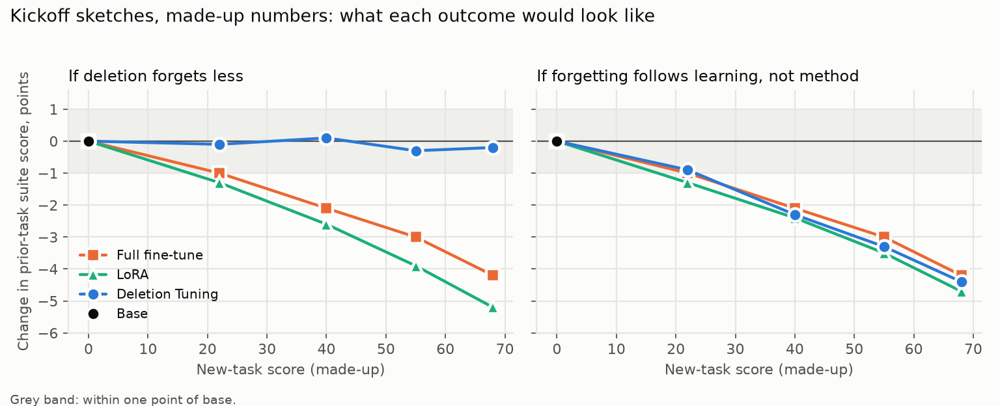
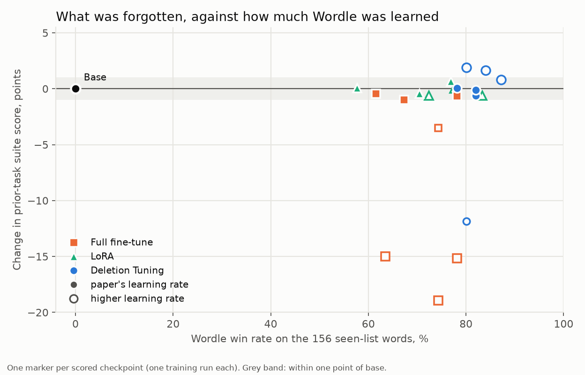
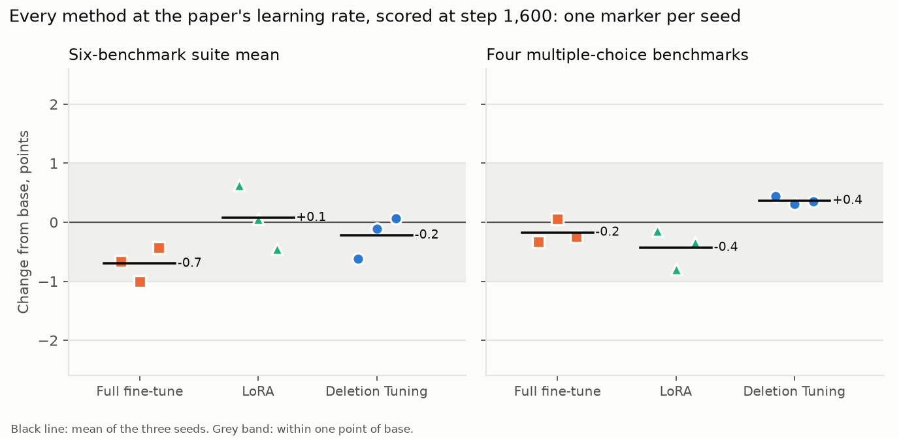
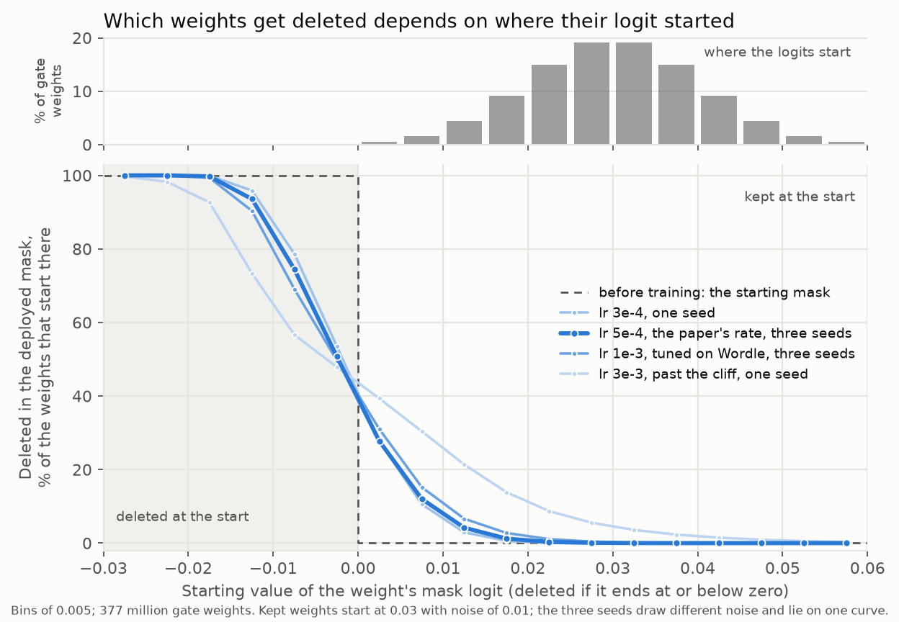

# Teaching LFM3-1.7B Wordle by deleting weights, and what each tuning method forgets

## Why

Lu et al. ("The Surprising Effectiveness of Deleting Weights in LLM Post-Training",
arXiv 2611.10866) claim that a model can be post-trained by learning only which weights to
zero. Their method, Deletion Tuning (DT), learns a binary mask over the MLP gate projection of
every block. They report that it matches full fine-tuning (FFT), that the mask is a megabyte
or so, and that the tuned model keeps its prior abilities where FFT and LoRA lose 1 to 5
points. The retention result is shown for reinforcement learning only.

I wanted to know whether this holds for the thing most people actually do: supervised
fine-tuning of a small, current model on an odd task, on one consumer GPU. Does deleting
weights learn the task, and does it leave the rest of the model more intact than full
fine-tuning or LoRA do?

## Setup

**Model.** `LiquidAI/LFM3-1.7B`, released 2026-10-23: 24 blocks (13 gated short convolutions,
5 sliding-window attention, 6 global attention), each with a SwiGLU MLP. 1.73B parameters.
The gate projections DT masks hold 377M weights, 21.8% of the model. The size was chosen so
that FFT with fp32 AdamW fits on a 32 GB card (26.9 GiB peak).

**New task.** `openenv/wordle-tool-calls-sft` (published 2026-10-19): 1,000 Wordle games won
by a scripted solver, written as conversations in which the assistant reasons briefly and
calls a `guess` tool each turn. 950 games train, 50 give a validation loss. Models are scored
by playing: a local simulator mirrors the TextArena environment (it reproduces every
environment message in the 1,000 published games) and the model plays one greedy game per
secret word, with a 256-token turn budget.

The environment draws secrets from 156 words and every one of them is an answer in the
training data. So there are two pools: the **seen-list** (those 156) and a **held-out** pool
of 800 common five-letter words that appear nowhere in training (300 validation, 500 test).

**Methods.** All three share the data order, batch size 4, AdamW, fp32 master weights with
bf16 autocast, a constant learning rate, and loss on assistant tokens only. Runs are 1,600
steps. The paper's SFT runs are 400; a LoRA pilot here was still improving at 800.

- FFT: all 1.73B weights.
- LoRA: rank 4, alpha 8, on all 153 linear projections inside the blocks. 4.1M parameters.
- DT: one logit per gate-projection weight, soft mask `sigmoid(alpha * G)` with alpha ramped
  from 100 to 1,000 over the run, hard mask `G > 0` at deployment, Wanda-prior initialisation
  at eta = 1/2048, regulariser 1e-5. The mask is stored as packed bits, zstd-compressed.

**Learning rates.** Two sets, three seeds each (42, 43, 44).

- *The paper's SFT rates:* FFT 3e-6, LoRA 1e-4, DT 5e-4. Every run is scored at step 1,600,
  so no checkpoint is chosen. DT was also run at the paper's exact recipe: 400 steps, with
  the sharpness ramp over those 400.
- *Rates tuned on Wordle:* fourteen configurations on seed 42, taking per method the one with
  the best seen-list checkpoint. That gave FFT 3e-5, LoRA 3e-4 and DT 1e-3. These are compared
  at each method's earliest saved checkpoint that reaches a common seen-list level (79.5% on
  seed 42, within one standard error): step 1,000, 1,000 and 400.

Two more learning rates have a suite score on seed 42 only: FFT at 1e-5 and DT at 3e-3.

**Prior-task suite.** The paper's six benchmarks through lm-evaluation-harness 0.4.12:
HellaSwag (10,042 items), MMLU (14,042), TruthfulQA MC1 (817), WinoGrande (1,267), IFEval
(541), HumanEval (164). The suite score is their unweighted mean. That mean gives a
164-problem benchmark the weight of a 14,042-question one, so I also report the mean of the
four multiple-choice benchmarks. Multiple choice and HumanEval are scored completion-style;
IFEval goes through the chat template with thinking off.

**Evaluation path.** Every model, base included, is scored as it would be deployed in bf16:
FFT's weights cast down, LoRA unmerged, DT's zeros written into the gate projections. The
base model was scored in both sessions of the run and came out identical on every item.

**Intervals.** Every comparison carries two 95% intervals. One is over seeds (t with 2
degrees of freedom, paired by seed for differences): would another training run agree? The
other is over items (paired bootstrap over benchmark items or secret words, seeds
averaged): would another sample of questions agree? With three seeds the first is wide. A
claim here needs both.

**Protocol.** Pre-registered in [`PROTOCOL.md`](PROTOCOL.md), with twelve dated amendments.
H1: DT recovers at least 90% of FFT's gain on the new task. H2, the primary hypothesis: at
matched new-task score, DT loses at least a point less on the suite than FFT and than LoRA.
H2 was registered for the Wordle-tuned configurations. The comparison at the paper's rates
was registered later (amendment 11), after the Wordle-tuned results were known, with its own
rules: a method "forgets" if its six-task change is -1.0 or lower with both intervals below
zero, and two methods "differ" if their gap on the multiple-choice mean has the same sign on
all three seeds and both intervals clear of zero. The suite was never used to choose a
configuration or a checkpoint. The description of the masks in section 5 and the cost table
in section 6 are exploratory and were not registered.

## Results

### 1. Every method learns the environment. None learns Wordle

The base model wins 0 of 156, 0 of 300 and 0 of 500. It opens with APPLE, then spends its
turn puzzling over what the feedback block means and never guesses again. Four decoding
settings, including a 4,096-token turn budget and the vendor's sampling defaults, all give
0 of 24. Its suite score is 48.7.

*Seen-list win rate along training for the three methods at the paper's learning rates.
Heavy lines are the mean of three seeds, thin lines the seeds; each point is 156 greedy
games. Look at where each method levels off and when.*

| seen-list win, mean of 3 seeds | step 400 | step 1,200 | step 1,600 (seeds 42 / 43 / 44) |
|---|---|---|---|
| FFT, paper's rate | 56.8% | 81.0% | 69.0% (78.2 / 67.3 / 61.5) |
| LoRA, paper's rate | 40.8% | 70.7% | 68.4% (76.9 / 57.7 / 70.5) |
| DT, paper's rate | 70.1% | 82.1% | 80.8% (82.1 / 82.1 / 78.2) |
| DT, paper's 400-step recipe | 64.7% (64.7 / 69.2 / 60.3) | | |
| FFT, Wordle-tuned rate | | | 70.7% (76.9 / 55.8 / 79.5) |
| LoRA, Wordle-tuned rate | | | 66.2% (75.0 / 62.8 / 60.9) |
| DT, Wordle-tuned rate | | | 84.4% (88.5 / 83.3 / 81.4) |

**DT learns the task as well as FFT.** It reaches about 80% by step 800 and stays there. FFT
at the paper's rate reaches the same level at step 1,200 and falls back by 1,600 on every
seed, as its validation loss rises. LoRA levels off near 70%. At step 1,600 DT is at or
above FFT in all six seed-by-setting pairs, by 2 to 28 points. The mean gap is 11.8 points at
the paper's rates and 13.7 at the tuned ones, but over three seeds the intervals are -5 to
+29 and -19 to +46. So "as well as" is supported and "better than" is not. H1 holds: DT
recovers 117% and 119% of FFT's gain, and at least 100% on every seed.

On the paper's own 400-step schedule, DT wins 64.7% against 56.8% for FFT and 40.8% for LoRA
at the same step, and is ahead on every seed. None of the three has finished learning by
then.

**None of them learns Wordle.** On words outside the training list no method gets past 5%
(DT at the paper's recipe: 3.2% of 500). Wins take about three guesses, close to the
solver's 2.7. The models learn to read the board and narrate it correctly, and then propose
candidates from the 156 words they have seen. The dataset teaches this environment, not the
game.

**The mask has to be trained.** The untrained mask (the Wanda prior plus init noise, 0.04%
of weights zeroed) wins 0 of 156 and 0 of 300.

### 2. At the paper's learning rates, nothing is forgotten

*Change in the six-benchmark suite score against learning rate, the three methods on one
axis. "paper" marks the paper's SFT rate for that method and "tuned" the rate chosen on
Wordle score alone; filled markers are means of three seeds with the seeds as small dots,
open markers are one seed. Every point wins 68 to 84% of seen-list games. Look at the three
"paper" points inside the grey band, and at how far the same method falls at a higher rate.*

Change from base at the paper's rates, step 1,600, three seeds:

| | six-task suite, seeds 42 / 43 / 44 | mean | over seeds | over items | multiple-choice mean | over seeds | over items |
|---|---|---|---|---|---|---|---|
| FFT | -0.7 / -1.0 / -0.4 | **-0.7** | -1.4 to 0.0 | -2.0 to +0.5 | -0.2 | -0.7 to +0.3 | -0.6 to +0.3 |
| LoRA | +0.6 / +0.1 / -0.4 | **+0.1** | -1.3 to +1.4 | -1.1 to +1.3 | -0.4 | -1.3 to +0.4 | -0.9 to 0.0 |
| DT | -0.6 / -0.1 / +0.1 | **-0.2** | -1.1 to +0.7 | -1.1 to +0.7 | +0.4 | +0.2 to +0.5 | 0.0 to +0.7 |
| DT, 400-step recipe | -0.3 / +0.3 / +0.5 | **+0.2** | -0.9 to +1.3 | -0.7 to +1.1 | +0.2 | -0.4 to +0.8 | -0.2 to +0.5 |

No method meets the registered definition of forgetting, and every mean is within a point of
base. All three have learned the task to 68 to 81%. So at the settings the paper recommends,
H2 cannot be tested on this model and task: there is no forgetting for deletion to avoid.

Per benchmark, the same runs:

| change from base | HellaSwag | MMLU | TruthfulQA | WinoGrande | IFEval | HumanEval |
|---|---|---|---|---|---|---|
| FFT | 0.0 | +0.3 | -0.4 | -0.6 | -7.0 | +3.5 |
| LoRA | +0.1 | -1.1 | -0.2 | -0.5 | -2.1 | +4.3 |
| DT | +0.2 | +0.8 | -0.1 | +0.6 | -2.6 | -0.2 |

The multiple-choice benchmarks barely move. IFEval and HumanEval do, in opposite
directions, and section 4 shows that both movements are habits picked up from the Wordle
turns, not lost or gained ability.

### 3. At higher learning rates, full fine-tuning and Deletion Tuning both collapse

| | learning rate | seeds | step | seen-list win | suite change | IFEval | answers with Wordle text, of 541 |
|---|---|---|---|---|---|---|---|
| FFT | 3e-6, paper's | 3 | 1,600 | 69.0% | -0.7 | -7.0 | 11 to 15 |
| FFT | 1e-5 | 1 | 1,200 | 74.4% | -3.5 | -22.0 | 111 |
| FFT | 3e-5, tuned | 3 | 1,000 | 72.0% | **-16.4** | -57.0 | 320 to 418 |
| LoRA | 1e-4, paper's | 3 | 1,600 | 68.4% | +0.1 | -2.1 | 3 to 5 |
| LoRA | 3e-4, tuned | 3 | 1,000 | 77.8% | -0.4 | -6.8 | 2 to 5 |
| DT | 5e-4, paper's | 3 | 1,600 | 80.8% | -0.2 | -2.6 | 0 to 4 |
| DT | 1e-3, tuned | 3 | 400 | 83.8% | +1.5 | -0.6 | 9 to 11 |
| DT | 3e-3 | 1 | 400 | 80.1% | **-11.8** | -53.8 | 474 |

**FFT at ten times the paper's rate is a Wordle bot.** Asked to write a resignation email, it
repeats the request and carries on "I'll start with STARE: five distinct, frequent words".
Other prompts get a bare tool call. It loses 16.4 suite points (15.2, 15.0 and 18.9 on the
three seeds; -21.9 to -10.8 over seeds) and wins about as much Wordle as FFT at the
paper's rate.

**DT is not protected by being a mask.** At six times the paper's rate, on one seed, it
zeroes 1.4% of all weights, wins the same 80% of games, and 474 of its 541 IFEval answers are
Wordle text.

**LoRA has no cliff in the range that learns the task.** At three times the paper's rate it
is intact. At ten times it stopped learning Wordle (61%) and I did not score the suite.

**Neither the new-task score nor the validation loss warns of the collapse.** Wordle
scores are the same on both sides of each cliff, and validation loss is between 0.061 and
0.076 for every checkpoint in the table. Equal fit to the new data did not mean equal
distance from the base model.

*Seen-list win rate along training for the fourteen tuning runs on seed 42, 156 games per
point. Within a panel, darker is a higher learning rate and the heavy line is the
configuration tuning chose. A single point carries about 4 points of noise. Look at the FFT
panel: the rates from 3e-6 to 3e-5 are hard to tell apart.*

**The registered primary comparison is this contrast, and I do not count it as support for
H2.** At the Wordle-tuned configurations and matched checkpoints the suite changes are FFT
-16.4, LoRA -0.4 and DT +1.5. DT minus FFT is +17.8 (11.8 to 23.9 over seeds, 16.4 to 19.2
over items) and DT minus LoRA is +1.9 (-0.4 to +4.2 over seeds, 0.9 to 2.8 over items). The
criterion as registered, which used intervals over items, is met. Two things stop it meaning
"deletion forgets less":

- The FFT gap belongs to the learning rate. The same method at a tenth of the rate loses
  0.7, and DT at three times its tuned rate loses 11.8. Tuning could not tell FFT's rates
  apart: the best seed-42 checkpoints at 3e-6, 1e-5 and 3e-5 won 79.5, 76.9 and 85.3%, with
  4 points of noise on each. Selecting on validation loss over the same checkpoints takes
  FFT at 3e-6 and DT at 3e-3, and the result reverses.
- LoRA did not forget, and the DT-LoRA gap on the suite mean is not clear of zero over
  seeds.

The kickoff sketches, and the measurement on the same axes:

*Drawn before any run, with made-up numbers: what each outcome of H2 would look like.*

*Every scored checkpoint, one marker per training run: suite change against seen-list win
rate. Filled markers are the paper's learning rates, open markers higher ones. Compare with
the sketches: the measurement is neither.*

Both sketches assumed that forgetting grows as the new task is learned. It does not. All
the checkpoints sit at 58 to 87% wins, and whether one is at zero or 15 points down depends
on its learning rate. At the paper's rates this is the third picture named at kickoff, all
three methods flat at zero.

### 4. What does move below the cliff

**IFEval moves because of a formatting habit.** The Wordle turns are a short thought and
then an action. Tuned models start opening a thinking block on ordinary prompts although
thinking is switched off, and an answer that does so usually fails its instruction check
(15 to 36% pass). Answers that do not open one pass as often as the base model's:

| paper's rates, step 1,600 | answers opening a thinking block, of 541 (per seed) | pass rate of the other answers |
|---|---|---|
| Base | 60 | 76.9% |
| FFT | 183 / 219 / 171 | 78 to 80% |
| LoRA | 123 / 115 / 138 | 79 to 81% |
| DT | 124 / 85 / 84 | 76 to 79% |

FFT picks the habit up most, which is its 7-point IFEval drop. At the collapsed settings the
other answers fail too (10 to 16% pass), because they are Wordle text.

**HumanEval moves because of a habit too.** Reading the completions for base, DT and LoRA
(seed 42, tuned rates): base stalls on 29 of 164 problems, writing `pass` or a TODO followed
by prose. DT stalls on 22 and LoRA on 8, their completions are shorter, and about half of
the problems they gain are ones where base had stalled. Wordle training taught them to act
instead of deliberating, and a 164-problem completion benchmark rewards that. The rises of 3
to 7 points are not coding skill.

**On multiple choice, DT is about a point above LoRA.** This is the one difference between
methods that the data supports.

*Change from base at the paper's learning rates, one marker per seed (three per method),
black line the mean. Left: six-task suite mean. Right: mean of the four multiple-choice
benchmarks, 26,168 items. Look at the right panel: DT's three seeds sit above LoRA's.*

| DT minus LoRA, multiple-choice mean | gap | over seeds | over items | same sign on every seed |
|---|---|---|---|---|
| Paper's rates | +0.8 | +0.1 to +1.5 | +0.4 to +1.2 | yes |
| Wordle-tuned rates | +1.4 | +0.4 to +2.4 | +0.9 to +1.9 | yes |

It meets the registered rule for "methods differ". Most of it is MMLU (DT +0.8, LoRA -1.1 at
the paper's rates). DT minus FFT at the paper's rates is +0.5 with an interval over seeds of
-0.1 to +1.2, so that gap is not established. DT itself sits at or slightly above base on
multiple choice in all eleven of its scored runs short of the cliff (0.0 to +0.8). I have no
explanation for that and did not chase it. The gap is small. Neither adapter is damaged at
either rate.

### 5. The mask

| DT mask | weights zeroed, % of the model | compressed size |
|---|---|---|
| Untrained (Wanda prior plus init noise) | 0.04 | 1.3 MB |
| Paper's recipe: lr 5e-4, 400 steps | 0.14 | 3.3 MB |
| lr 5e-4, 1,600 steps | 0.18 | 4.0 MB |
| lr 1e-3, step 400 | 0.30 | 5.8 MB |
| lr 3e-3, step 400 (collapsed) | 1.4 | 17.8 MB |

- **Size.** For comparison: the rank-4 LoRA adapter is 16.5 MB, a rank-1 LoRA 4.2 MB (it
  wins 78% of seen-list games on seed 42), an fp32 checkpoint 6.9 GB. The paper's SFT masks
  are 1.0 MB on a 1B model and 3.1 MB on a 3B one. So the size is in the paper's range and
  the density is not: the paper says under 0.05% of weights, and here training more than
  triples the 0.04% the mask starts with. How much is zeroed grows with learning rate and
  with steps.
- **Soft versus hard.** Training sees the soft mask and deployment the hard one. They agree
  from step 400: validation loss 0.0625 against 0.0627 at lr 1e-3. At step 200 they do not
  (0.077 against 0.087), so an early DT checkpoint is not what its training loss says it is.
- **Sharpness ramp.** The paper's GRPO ramp (1e3 to 1e4) freezes the mask by step 200 and
  reaches 10% wins. Its SFT ramp (1e2 to 1e3) is the one that works for SFT.

**What the mask is made of.** At the paper's rates after 1,600 steps (the three seeds agree
to within 2%):

| Part of the deployed mask | weights | share |
|---|---|---|
| Deleted during training | 2.62M | 85% |
| Zeroed by the init noise at the start, still zeroed | 0.28M | 9% |
| Chosen by the Wanda score at the start | 0.18M | 6% |

- **Most of the mask is learned, and the inherited part does nothing.** The learned share is
  79% at the paper's 400-step recipe and 91% at lr 1e-3. With the inherited deletions put
  back, the masks win as many games (83.5% against 80.8%; by seed 81, 81, 88 against 82, 82,
  78). The paper's RL masks look different: their density is the same at the first saved
  checkpoint and the last (its Table 7, 0.034 to 0.046% of all weights), roughly what the
  initialisation gives on its own. The paper reports no density for its SFT masks.
- **The starting noise decides which weights go.** A kept weight's logit starts at 0.03 plus
  noise of 0.01, and the weight is deleted if the logit ends at or below zero. Training moves
  logits only a short way before the sharpening mask freezes them: about 85% of the learned
  deletions are in place by step 400. So a weight that starts just above zero is deleted 28%
  of the time, and one that starts at 0.03 is deleted 0.02% of the time. Half of the learned
  deletions come from the 2% of weights that started within 0.01 of zero. It works the same
  in reverse: 45% of the noise-chosen starting deletions, which sit just below zero, are put
  back, against 0.3% of the Wanda-chosen ones.

*Share of gate weights deleted in the deployed mask, by where the weight's logit started,
for Deletion Tuning at four learning rates (three seeds at 5e-4 and 1e-3, one at 3e-4 and
3e-3). The dashed step is the mask before training. The bars above show where logits start.
Look at how little of the curve reaches the bulk of the weights: training blurs the starting
mask by under 0.02 at every rate short of the cliff.*

- **Seeds agree on where to delete, not on which weights.** Between two seeds, deletions per
  block correlate at 0.997, per residual dimension at 0.94 and per MLP unit at 0.70. But
  only 6% of the individual learned deletions are shared (8 times chance), and 1% are in
  all three. One seed at another learning rate or schedule, with the same starting noise
  and data order, shares 47 to 62%.
- **There is no small core.** The 9% of learned deletions that started at 0.02 or above,
  and so travelled furthest, win nothing on their own (0 of 156 on each seed). The other
  91% win 73%, which is 8 to 13 points below the whole learned set on every seed.
- **Shape.** Deletions grow with depth, from 0.4% of a block's gate weights in blocks 2 to
  5 to 1.0% in the last three. They lean toward small weights (the smallest twentieth by
  magnitude takes 7% of them, the largest 2%) and are unstructured: no MLP unit loses more
  than 17% of its inputs. Their number follows the learning rate, from 1.9 million at lr
  3e-4 to 24 million at 3e-3, with seen-list win rates of 72 to 87% throughout (seed 42).

### 6. Cost

| | Full fine-tuning | LoRA rank 4 | Deletion Tuning |
|---|---|---|---|
| Values trained | 1,729M weights | 4.1M | 377M mask logits |
| Peak GPU memory | 26.9 GiB | 10.2 GiB | 15.9 GiB |
| Time per step (4 games) | 0.38 s | 0.35 s | 0.33 s |
| 1,600 steps | 10.1 min | 9.2 min | 8.9 min |
| Stored result | 6.9 GB | 16.5 MB | 4.0 MB |

One RTX 5090, gradient checkpointing on, base weights held in fp32 for all three.

- **Memory.** DT sits between the other two. Its 5.7 GiB over LoRA is the mask's training
  state: a logit, its gradient and two Adam moments for each of 377M weights (5.6 GiB). The
  paper says the same in words and gives no figures.
- **Time.** A step costs about the same for all three. DT adds one forward pass over the
  training set for the Wanda scores (23 s).
- **Steps.** So the cost of reaching a Wordle level is the number of steps, and at the
  paper's rates DT needs fewer. It wins 70% of seen-list games at step 400 and 82% at step
  800. FFT is at 57% and 68%, LoRA at 41% and 59%. DT is ahead of both on every seed at both
  steps.
- **Deployment.** DT and FFT models are plain weights and run at the base model's cost.
  Zeroing 0.2% of weights at scattered positions buys no speed.

## Against the paper's claims

| Claim | Here |
|---|---|
| DT matches FFT under SFT | Consistent. DT is at or above FFT on every seed at both sets of learning rates and on the paper's 400-step schedule, on a different architecture and a newer model. |
| Megabyte-scale masks | Consistent. 3.3 MB at the paper's recipe, against 1.0 and 3.1 MB for the paper's SFT masks. |
| Under 0.05% of weights deleted (documented for the RL runs; the abstract says it of all regimes) | Not under SFT here. 0.14% at the paper's recipe, 0.18 to 0.30% with more steps or a higher rate. |
| Hard and soft masks agree at the end of training | Holds, from step 400. |
| The gain comes from learning the mask, not from the Wanda prior | Consistent. The untrained mask wins nothing, and the trained mask wins as much with its starting deletions put back. I did not run the paper's random-mask controls. |
| DT trains in less memory than FFT and more than LoRA (stated without figures) | Consistent. 15.9 GiB, against 26.9 and 10.2. |
| DT keeps prior abilities where FFT and LoRA lose 1 to 5 points (shown for RL) | Not testable under SFT here. At the paper's rates neither baseline loses a point. Where FFT does lose, at ten times the paper's rate, DT at six times its own loses nearly as much. I ran no RL and no random-sparse baseline, so the paper's claim as stated is untouched. |
| The paper's SFT hyperparameters | Transfer. All three methods learn the task at the paper's rates without damage. The GRPO sharpness ramp does not work for SFT, as the paper's per-regime settings imply. |

## Limitations

- One model, one task, 1,000 training games. The new-task score is a 156-word list seen in
  training, with no separate test split.
- Three seeds. Intervals over seeds are wide, and no Wordle difference between methods is
  established. FFT at 1e-5 and DT at 3e-3 have one seed, so DT's cliff rests on one run.
- Runs are 1,600 steps, not the paper's 400. The length was fixed after the pilot by a rule
  I had worded for the held-out score and applied to the seen-list (amendment 6). DT was run
  at the paper's 400-step recipe; the baselines' 400-step numbers are step 400 of their
  1,600-step runs, which is the same thing for a constant learning rate.
- The 256-token turn budget cuts off 13 to 15 of DT's turns per seed at the paper's rates
  (18 to 44 at the 400-step recipe) and 0 to 1 of the baselines'. A cut-off turn loses the
  game, and almost all of DT's games lost without a tool call are these. DT's Wordle scores
  are understated in a way the baselines' are not.
- The comparison at the paper's rates was registered after the Wordle-tuned results were in.
  On seed 42 I had already seen a suite score at each of those rates (at other steps for FFT
  and DT). Seeds 43 and 44 were new.
- The entry was not under version control while it ran, so the order of protocol and
  results rests on the lab notes and on file times.
- The suite was run with thinking off and multiple choice scored completion-style. How the
  tuned models behave in ordinary thinking-on chat was not measured.
- Measurement noise: a 156-game score moves about 4 points with batch padding alone, and
  three trainings of FFT at 3e-6 from the same seed scored 79.5, 83.3 and 88.5% at step
  1,200.
- No random-sparse baseline, so nothing here separates "deletion" from "any sparse update".
- The description of the masks and the cost table were not registered. They are exploratory,
  made on runs that already existed. The parts of masks were scored on seen-list Wordle only,
  not on the suite. Seeds differ in data order as well as starting noise, so the low
  agreement between seeds cannot be divided between the two.
- Cost is one GPU at a batch of 4 games, with every method's base weights in fp32.

## Verdict

On LFM3-1.7B and this Wordle dataset:

1. **Deleting weights is enough to learn the task, as well as full fine-tuning does.** A mask
   over 22% of the model, ending with 0.18 to 0.30% of all weights zeroed, wins 81 to 84% of
   seen-list games. It is at or above full fine-tuning on every seed, and ahead of both
   baselines on the paper's 400-step schedule. This part of the paper is consistent with what
   I see on a different architecture.
2. **Whether deletion forgets less could not be tested, because at sensible learning rates
   nothing forgets.** At the paper's rates all three methods learn the task and stay within
   a point of base on three seeds.
3. **Forgetting here is set by the learning rate, not the method.** Full fine-tuning at ten
   times the paper's rate loses 16 points and Deletion Tuning at six times loses 12, while
   winning the same share of Wordle games at the same validation loss. The pre-registered
   comparison, at rates tuned on Wordle alone, caught full fine-tuning past its cliff and
   Deletion Tuning short of its own, and would have read as a 17.8-point win for deletion.
4. **One small difference between methods survives:** Deletion Tuning is about a point above
   LoRA on multiple-choice accuracy, at both sets of rates and on every seed. Most of what
   else moves is a formatting habit, opening a thinking block on prompts that did not ask
   for one, and full fine-tuning picks that up most.
5. **The mask is megabytes, as advertised, but not as sparse, and it is not unique.** 3.3 to
   5.8 MB, three to six times the paper's density figure. 79 to 91% of it is learned, not
   inherited from the starting mask. Which weights are deleted follows the random starting
   noise: three seeds reach the same Wordle score sharing 6% of their deletions pair by pair.
6. **The dataset teaches an environment, not Wordle.** No method reached 5% on unseen words.

If I were using this: Deletion Tuning is a reasonable alternative to LoRA for a narrow
skill. It learned in fewer steps here, at LoRA's speed and about one and a half times
LoRA's memory. The artefact is about the size of a rank-1 LoRA, and it has none of LoRA's
precision loss when merged into bf16 weights. Whatever the method, start from
the paper's learning rates and check retention before raising them. The new-task score was
flat across a tenfold range of full fine-tuning rates in which forgetting went from nothing
to total.
