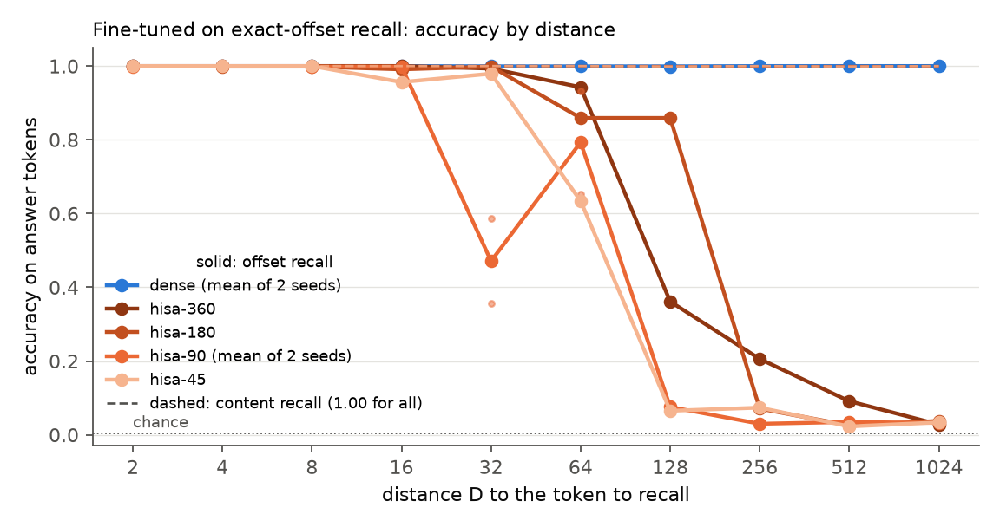

# What does HiSA give up? Exact far offsets, and two slow pairs (SmolLM-135M at 2K)

**Date:** 2026-11-21 · **Machine:** `local-3090` (one RTX 3090, 24 GB)

## Brief

HiSA (arXiv 2611.26363) drops the part of the attention score that RoPE pair l contributes once that
pair's rotation between query and key passes 90°, and argues that dense models learn to suppress those
parts anyway. Are the dropped parts noise, or exact token-offset information that prose rarely needs? I
tested this on pretrained SmolLM-135M at 2048 tokens in two ways: dropping the parts at inference on prose,
code, tables, synthetic grids and a copy probe, with matched controls; and fine-tuning dense and HiSA
variants on a task where the exact offset is the only route to the answer.

## Headline results

- **A model without the far-rotated parts cannot learn far exact-offset recall; the dense model learns it
  easily.** After 4000 fine-tuning steps dense recalls the token exactly D positions back at 1.00 for every
  D from 2 to 1024. hisa-90 is at 1.00 to D = 16, at 0.47 and 0.79 at 32 and 64 (means of two seeds that differ by up to
  0.3), and at 0.08 or less from 128 on. Content recall at the same distances is 1.00 for every variant. The cliff moves out with the
  angle budget (hisa-360: 0.94 at 64, 0.36 at 128), and HiSA's wrong answers are mostly the neighbouring
  tokens: it finds the neighbourhood and cannot resolve the position.
- **Without retraining, hisa-90 is not free on this checkpoint:** +0.218 nats per token on prose [0.208,
  0.230], +0.267 on code, +0.083 on tables (256 windows each), against the paper's +0.031 for its own
  model. On prose it is still 10 to 23 times cheaper than dropping the same number of pairs chosen any other
  way (+2.2 to +5.1).
- **Nearly all of that cost is two pairs.** It is +0.03 until position 1178 and then climbs to +0.9; 1178
  and 1571 are the 90° windows of pairs 23 and 24. Cutting pair 23 alone costs +0.475 on prose, more than
  the whole rule; pair 24 alone +0.070; pairs 18 to 22 at most +0.011 each. The pair-23 cost sits in layer
  13.
- **Beyond 180° the dropped parts are close to free on everything tested** (hisa-180: +0.009 or less), but
  at 2K that rule never reaches pairs 23 and 24, so this says nothing about them.
- **Short exact offsets use the 90–180° parts.** On the one grid size the dense model can do (8 cells per
  row), hisa-90 cuts the probability of the newline at the right place from 0.53 to 0.21 at every position
  in the window; hisa-180 and hisa-360 leave it alone.
- Verdict: mixed. The "rarely needed capability" reading holds for exact offsets; "nearly free on prose"
  does not hold for this checkpoint at 90°. One model, one context length, no retraining on prose.

*Accuracy on answer tokens after fine-tuning pretrained SmolLM-135M for 4000 steps, by distance D to the
token to recall (128 held-out sequences, about 675 queries per point; dense and hisa-90 are means of two
seeds, small dots are the seeds). Solid lines: recall the token exactly D positions back. Dashed: recall
the token after a unique key D positions back, 1.00 for every variant. Look at where each solid line
leaves 1.0.*

## Contents

| File | What |
|---|---|
| [REPORT.md](REPORT.md) | Method, results, limitations, verdict |
| [PROTOCOL.md](PROTOCOL.md) | The plan as revised before Stage 1, sketches, kill criteria, dated amendments |
| [LABNOTES.md](LABNOTES.md) | Execution log in order, including the first-token guess that was wrong |
| [code/](code/) | Keep-table attention, checks, evaluation, task, training, summaries, figures; see `code/README.md` |
| [results/](results/) | Stage 0 checks, Stage 1 summary, Stage 2 logs and summary, pair-23 localisation |
| [images/](images/) | Figures |
