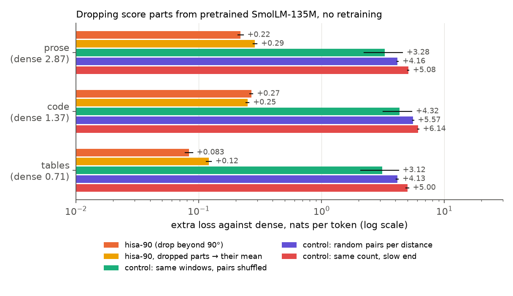
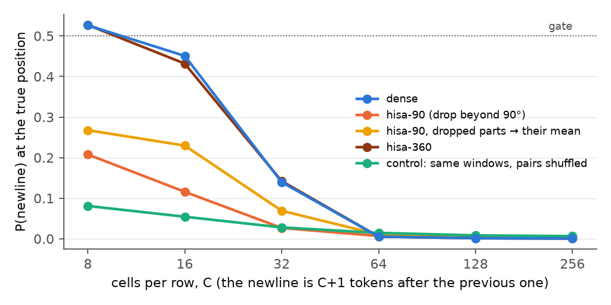

# What does HiSA give up?

## Question

With rotary position embeddings the attention score between a query and a key is a sum of 32 parts, one per
frequency pair, and pair l is rotated by (distance × θ_l). HiSA (arXiv 2611.26363) keeps a pair's part only
while that rotation is below a budget, 90° by default. The paper shows that models trained this way reach a
lower prose loss than dense ones and argues that dense models learn to suppress the dropped parts anyway.

Two readings fit the paper's evidence. The dropped parts are noise. Or they carry exact token-offset
information that prose almost never needs. The paper evaluates prose only; the readings differ on data
where token offsets matter.

Hypothesis, fixed before measuring ([PROTOCOL.md](PROTOCOL.md)): the dropped parts carry exact-offset
information; dropping them is nearly free on prose, costly where offsets are regular, and a model without
them cannot learn far exact-offset recall that the dense model can.

## Method

Model: HuggingFaceTB/SmolLM-135M (30 layers, 9 query heads over 3 key heads, 32 pairs per head, RoPE base
10000), context 2048, fp32 for evaluation.

Every condition is a table M[pair, distance] saying which parts are kept. The implementation is exact and
was checked against the paper's reference code (Stage 0: pair layout, frequencies, identity with the stock
model to 2e-4 in logits, agreement with the paper's reference to 6e-5).

**Stage 1, drop at inference, no training.** Conditions:

- `hisa-Φ` for Φ = 45, 90, 180, 360, 720°.
- `band-a-b`: drop only the parts rotated between a and b.
- Controls that drop the same number of pairs as hisa-90 at every distance: `ctrl-perm` (the 32 hisa-90
  windows shuffled over the pairs, 3 seeds), `ctrl-iid` (random pairs at each distance), `ctrl-slow` (the
  windows in reverse order, so the slowest pairs are cut first).
- `hisa-90-mean`: dropped parts replaced by their mean over queries, per layer, head, pair and distance,
  measured on 64 held-out prose windows. Added because the dropped parts do not average to zero.
- Added after the first pass: `-keep1` (the first key keeps every pair) and `pair-l-90` (only pair l is cut).

Data, 2048-token windows, identical across conditions: 256 OpenWebText documents; 256 Python files; 256
windows of real CSV, JSON-lines and markdown tables; synthetic grids of C single-token cells per row and a
newline, C from 8 to 256, 64 windows each; 256 prose windows with a 32-token span repeated after a gap of
64 to 1536. Differences are paired by window with a bootstrap 95% interval.

A grid size counts only if the dense model puts at least 0.5 probability on the newline at its true
position.

**Stage 2, can HiSA learn exact offsets?** A 2048-token stream of random words with two kinds of query
embedded in it, about 105 per sequence. Offset: a marker for D, then the token exactly D positions before
the marker. Content: a marker, a key that occurred once D positions earlier, then the token that followed
it. D from 2 to 1024 (content from 4). Pretrained SmolLM-135M, all weights tuned, loss on answer tokens,
4000 steps of batch 8 at 1e-4, mask on from step 0. Variants: dense and hisa-90 (two seeds), hisa-45,
hisa-180, hisa-360 (one seed). Accuracy on 128 held-out sequences, about 675 queries per variant and D.

## Results

### 1. HiSA cannot learn far exact offsets; dense can

*Accuracy on answer tokens after 4000 fine-tuning steps, by distance D, dense against four HiSA budgets
(128 held-out sequences, about 675 queries per point). Solid: offset recall. Dashed: content recall (1.00
everywhere). Dense and hisa-90 are means of two seeds; small dots are the seeds. Look at where each solid
line leaves 1.0 while its dashed line stays there.*

| variant | 16 | 32 | 64 | 128 | 256 | 512 | 1024 |
|---|---|---|---|---|---|---|---|
| dense (2 seeds) | 1.000 | 1.000 | 1.000 | 1.000 | 1.000 | 1.000 | 1.000 |
| hisa-45 | 0.956 | 0.979 | 0.634 | 0.065 | 0.074 | 0.023 | 0.034 |
| hisa-90 (2 seeds) | 0.998, 0.998 | 0.586, 0.356 | 0.933, 0.653 | 0.074, 0.077 | 0.033, 0.026 | 0.028, 0.041 | 0.032, 0.032 |
| hisa-180 | 0.991 | 0.999 | 0.859 | 0.859 | 0.071 | 0.026 | 0.038 |
| hisa-360 | 1.000 | 0.993 | 0.943 | 0.361 | 0.206 | 0.091 | 0.028 |

All variants are at 0.997 or better for D = 2, 4, 8, and content recall is 0.999 or better for every
variant at every distance. So the far key can be found and read by a HiSA model when its content
identifies it; what is missing is addressing it by position alone.

The dense model reaches ceiling at every distance within 1000 steps. Exact addressing at 1024 tokens is not
hard for a RoPE model.

The cliff moves out as the budget grows, less tidily than the factor of four per factor of four the plan
guessed, and hisa-45 is no worse than hisa-90.

Where HiSA fails it is nearly right. At the cliff most wrong answers are the token one position off (hisa-90
at D = 32: 268 of 301 and 337 of 468 in the two seeds; hisa-360 at D = 128: 332 of 431). Further out the
errors spread over a few dozen neighbouring positions. The floor of 0.03 to 0.08 is above chance (0.004)
for that reason.

Two cautions. The HiSA runs were still improving at the cliff when they stopped (hisa-90 at D = 64: 0.13,
0.78, 0.90, 0.93 at steps 1000, 2000, 3000, 4000), and the two hisa-90 seeds differ by up to 0.3 there, so
the cliff's position after 4000 steps is not its position at convergence. Beyond it (D ≥ 128 for hisa-90)
nothing moved in 4000 steps. And hisa-90 is worse at 32 than at 64 in both seeds; HiSA's hard window edges
give it exact-distance cues at particular distances, which may explain it, but I did not test that.

### 2. Without retraining, hisa-90 is not free on this checkpoint

*Extra loss against dense for hisa-90, its mean-ablation variant and three controls that drop the same
number of pairs, log scale, 256 windows per data type. Bars: mean; lines: bootstrap 95% interval (for the
shuffled control, the range over 3 seeds). Look at the gap between hisa-90 and the controls, and at how
little the three data types differ.*

| condition | prose (2.868) | code (1.372) | tables (0.712) |
|---|---|---|---|
| hisa-45 | +1.556 | +2.013 | +1.838 |
| hisa-90 | +0.218 [0.208, 0.230] | +0.267 [0.259, 0.276] | +0.083 [0.078, 0.089] |
| hisa-180 | +0.009 [0.007, 0.012] | +0.009 [0.007, 0.010] | +0.005 [0.004, 0.006] |
| hisa-360 | +0.003 | +0.001 | +0.002 |
| hisa-720 | +0.0007 | +0.0002 | +0.0001 |
| hisa-90-mean | +0.287 | +0.250 | +0.121 |
| band-90-180 | +0.699 | +0.893 | +0.513 |
| band-180-360 | +0.013 | +0.013 | +0.007 |
| ctrl-perm (3 seeds) | +2.23 to +4.57 | +3.17 to +5.44 | +2.08 to +4.24 |
| ctrl-iid | +4.16 | +5.57 | +4.13 |
| ctrl-slow | +5.08 | +6.14 | +5.00 |

- hisa-90 costs 0.22 nats on prose, against 0.031 in the paper for its own 4K model. The comparison is
  loose (different model, different context), but this checkpoint leans on the dropped parts more.
- Which pairs are dropped matters far more than how many. The same count taken from anywhere else costs 2
  to 6 nats (10 to 23 times the hisa-90 cost on prose and code, 25 to 60 times on tables); taken from the
  slow end it is worst.
- Dropping only the 90–180° band is three times worse than dropping it together with everything beyond.
  The parts beyond 180° are not independent of the band below them.
- Replacing the dropped parts by their mean does not help. Most of the energy of the dropped parts is a
  fixed function of distance (93% in the 90–180° band), but that is not what the model misses.
- Code and tables do not stand out from prose. On tables the cost per newline token is +0.16 against +0.10
  on other tokens; on code newlines cost less than other tokens.
- Copy accuracy on the repeated span: dense 0.83, hisa-90 0.53, hisa-180 0.76, hisa-360 0.83. Restricted to
  repeats before position 1100: 0.85, 0.71, 0.85, 0.86, and for hisa-90 it falls with the gap (0.84 at 64,
  0.50 at 512). The paper's copy result is for trained HiSA models; this is the untrained switch.

### 3. Nearly all of the prose cost is two pairs

*Extra loss against dense by position in the window, for the whole hisa-90 rule and for single pairs cut
beyond 90° (prose, 256 windows, 64-token bins). Dotted lines: the distances at which pairs 22, 23 and 24
pass 90°. Look at where the hisa-90 line leaves the floor, and at the pair-23 line above it.*

The cost of hisa-90 is flat at +0.02 to +0.04 for the first 1150 positions and then climbs to +0.9, with a
second rise near 1570. Those are the 90° windows of pairs 23 and 24 (1178 and 1571 tokens).

| only this pair cut beyond 90° | 18 | 19 | 20 | 21 | 22 | 23 | 24 |
|---|---|---|---|---|---|---|---|
| extra loss on prose | +0.003 | +0.001 | +0.006 | +0.002 | +0.011 | +0.475 | +0.070 |

Cutting pair 23 alone costs more than twice the whole hisa-90 rule; the other dropped pairs partly offset
it. Pair 22 spends positions 884 to 1767 between 90° and 180° and costs 0.01, so this is about the pair,
not the angle band. A first guess, that the first token of the window is the key involved, was wrong:
letting the first key keep every pair changes nothing (3.091 against 3.086).

The pair-23 cost sits in layer 13: cut there alone it costs +0.49 over positions from 1280 on, against
+0.03 or less in any other layer (64 windows). Inside layer 13 no single head carries it (largest +0.06,
all nine sum to +0.15).

This qualifies the cheap hisa-180 result. At 180° the windows of pairs 23 and 24 are longer than 2048
tokens, so that rule never cuts them here. Pairs 25 to 31 are never cut at 2K under any budget tested.

### 4. Short exact offsets use the 90–180° parts

*Probability the model gives the newline at its true position on synthetic grids, by cells per row, dense
against four ways of dropping parts (64 windows per size; rows after the third). Only C = 8 passes the
gate. Look at hisa-90 against dense and hisa-360 there.*

The dense model passes the gate only at C = 8 (0.53; 0.45 at C = 16, 0.14 at 32, nothing from 64 on). At
C = 8, hisa-90 lowers the probability to 0.21 and raises the newline loss by 1.02 nats [0.98, 1.05];
hisa-180 and hisa-360 do not hurt (0.58 and 0.53). The effect is the same before position 1100 (0.51 to
0.20) and after 1280, so it is separate from pair 23. C = 16, which misses the gate, shows the same pattern.
The pretrained model does not place newlines at offsets beyond 33 tokens at all, so Stage 1 cannot speak to
far exact offsets; Stage 2 does.

## Limitations

- One model, 135M parameters, 64-dimensional heads, context 2048. The seven slowest pairs are never cut.
- Stage 1 has no retraining: it measures what this dense checkpoint uses, mixed with distribution shift.
  The paper reports that continued training recovers the loss on prose; I did not continue training on
  prose, so the +0.22 is not a claim about a trained HiSA model.
- Stage 2 is one synthetic task, 4000 steps, one learning rate chosen on dense, two seeds for dense and
  hisa-90 and one for the other budgets. The cliff positions are not converged values.
- The grid probe passes its gate at one size only.
- The pair-23 finding is located (layer 13) but not explained. I did not inspect attention patterns.
- OpenWebText has no official validation split; the prose windows are the first long documents of the
  stream.

## Verdict

Mixed, scoped to SmolLM-135M at 2K.

The dropped parts are not noise. They are what lets a model address a token by exact position beyond a few
dozen tokens: with them the task is learned to 1.00 at every distance, without them accuracy falls to a
few percent from 128 tokens on (hisa-90), while content addressing at the same distances is untouched.
HiSA keeps coarse far position and exact near position, and gives up exact far position.

Against the sketches drawn before the runs: Stage 2 is the "hypothesis holds" sketch with a less tidy
ordering of the budgets. Stage 1 is neither sketch: the prose bar is far larger than drawn, code and tables
do not exceed prose, and of the grids only C = 8 could be scored (+1.02 nats on its newline tokens).

"Nearly free on prose" does not hold for this checkpoint at 90° without retraining: +0.22 nats, almost all
of it from two slow pairs in the second half of the window, +0.03 elsewhere. Beyond 180° the parts are
close to free on prose, code, tables and the one usable grid, for the pairs that 2K can reach.
