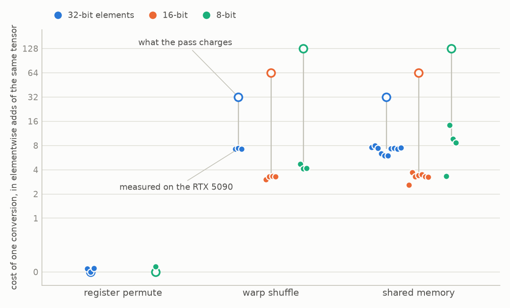

# Triton's layout-conversion pass: wrong prices that rarely matter, and a choice made with no price at all

**Date:** 2026-11-21 · **Machine:** `worker-b` (one RTX 5090, 32 GB, sm_120)

## Brief

Triton gives every tensor value a layout and inserts `convert_layout` where producer and
consumer disagree. One pass, `RemoveLayoutConversions`, decides where those conversions end
up: `resolveConflicts` picks a layout by a fixed rule when a value could take several, and
`isRematBeneficial` weighs a price for a conversion (`32 * bytes`, or 0 for a register
permute) against a price for recomputing its inputs in the other layout. Does either
decision leave performance behind on real kernels, and if so is it the rule or the prices?

Triton is pinned at `359c5be7`, built from source with a JSON-lines logging patch and an
override patch. The corpus is seven Triton tutorials across their autotune grids, the
kernels Inductor generates for four models, and the in-tree `triton_kernels` matmul suite,
compiled for sm_80, sm_90, sm_100 and sm_120: 2,554 kernel configurations on sm_120.
Timing is on the RTX 5090 only.

## Headline results

On sm_120, the card's own target:

- Across 2,554 kernel configurations, the pass faced a real choice in 339 (13%). Insertion
  order settles every one, apart from 16 atomics: no conflict offers an MMA layout to
  prefer, so the rule in the source decides nothing here.
- Of 3,026 conversions that survive the pass, 65% are shared-memory round trips, 5% warp
  shuffles, 30% free.
- 1.1% of conversions the pass priced as shared-memory round trips lower to a warp shuffle
  instead; repricing them at the measured cost of a shuffle flips 0 of 32,697
  rematerialization decisions.
- A warp-shuffle conversion costs 7.2 elementwise adds of the same tensor and a
  shared-memory one costs 7.6, against an assumed 32 (20.2 ns and 21.3 ns of SM time for a
  4 KB fp32 tensor). The two classes cost the same, so one price for both is right. The
  price itself is 4 to 30 times too high against arithmetic.
- Where an alternative resolution changes a layout, the best one beat the default by at
  most 11.6% (Inductor's batch-norm backward reduction, 2.46 µs against 2.15 µs); median 0
  over 46 conflicted kernels. With ptxas 12.9 as the assembler in place of the bundled 13.5
  it is 12.3%.
- The largest gap of all is not a layout difference: one alternative build of
  triton_kernels' `_matmul` for fp8 activations and mxfp4 weights runs in 123 µs against
  the default's 3,169 µs, 96.1% less. The two builds hold the same operations on the same
  layouts in a different order. Its size depends on the assembler: with ptxas 12.9 it is
  244 µs against 3,691 µs, 93.4% less.

What follows from those:

- **The wrong price barely matters, and the measured one is not better.** When a priced
  conversion is at stake, rematerialization wins 13,101 comparisons and loses 167,
  typically by a factor of a thousand. Recompiled at the measured price (0.12 of the
  assumed one), no tutorial kernel changes. Of 21 changed Inductor and triton_kernels
  builds timed on the card, eight are slower (3% to 45%), four faster (5% to 9%) and nine
  no different.
- **Where the choice changes the program, the default is usually the best of those tried.**
  Of 140 distinct alternative programs timed on 25 kernels, twice each, 37 are slower than
  the default and 13 faster. The 13 are on four kernels.
- **The alternatives that win do not win by removing conversions.** On Inductor's
  batch-norm backward reduction the default has one shared-memory conversion in its loop
  and all six faster builds (up to 11.6%) have two. On the triton_kernels matmul no layout
  differs at all: one `local_load` sits six operations earlier in the slow build, ptxas
  drops from 255 registers to 40 and spills 7.9 KB per thread, and the kernel runs 26 times
  slower. For a sibling specialization the default has the fast order and the alternative
  is 5.9 times slower. Six ptxas releases from 12.8 to 13.5 make the same fallback on the
  same two builds; timed with 12.9 the factors are 15 and 5.0. The pass has a price for
  neither effect.

*What the pass charges for one conversion (open rings) against what it costs on the RTX
5090 (filled dots, one per measured conversion of 1 KB or more), by lowering class and
element width, in units of one elementwise add of the same tensor. 35 conversions, 25 timed
runs each. Look at the gap between each ring and its dots, and at how little the dots move
between the middle and right-hand groups.*

## Contents

| File | What it is |
|---|---|
| [`REPORT.md`](REPORT.md) | Method, results with one table per experiment, verdict, limitations |
| [`LABNOTES.md`](LABNOTES.md) | The run in order: amendments, failures and corrections |
| [`code/`](code/) | Patches against the pinned commit, census drivers, microbenchmarks, analysis; [`code/README.md`](code/README.md) has the commands |
| [`results/`](results/) | Summaries and generated tables for each experiment (`report_tables.md` has every table per section and target, `ptxas_tables.md` the check under other ptxas releases), raw E3 and E4 results, and four archives: `census_evidence_sm120.tar.xz`, `e4_results.tar.gz` and `e4_ptxas12.9_results.tar.gz`, from which the analysis rebuilds the sm_120 census tables, the E4 tables and the ptxas tables, and `e4_ttgir_sm120.tar.gz`, the final TTGIR of every build compared on the card |
| [`images/`](images/) | The three figures |
