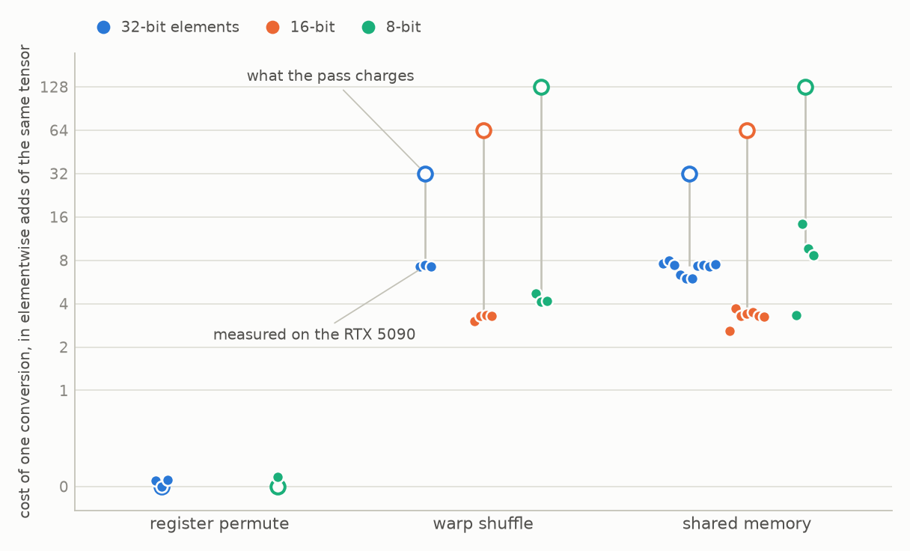
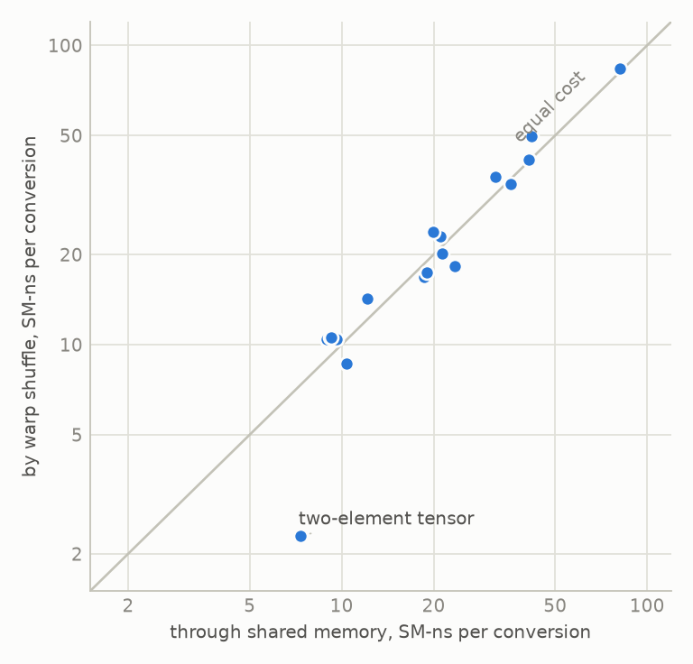
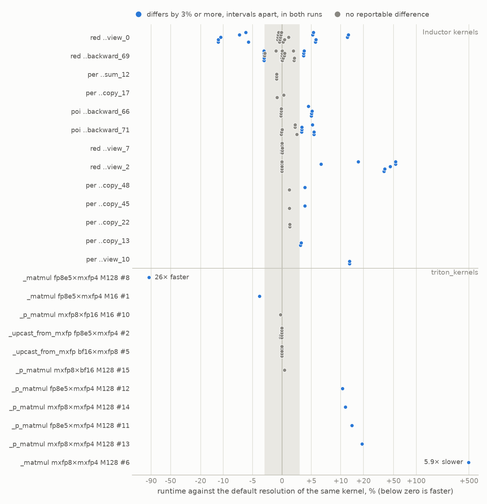

# Does Triton's layout-conversion pass leave performance behind?

**Date:** 2026-11-21 · **Machine:** `worker-b` (one RTX 5090, 32 GB, compute capability 12.0, driver 580.95.05, CUDA runtime 13.2)

## Question

Triton gives every tensor value a layout (how its elements map to registers, lanes and
warps) and inserts `convert_layout` where a producer and a consumer disagree. One pass,
`RemoveLayoutConversions`, decides where those conversions end up. It makes two kinds of
decision. When a value could take more than one layout, `resolveConflicts` picks one by a
fixed rule and consults no cost. When a conversion could be removed by recomputing its
inputs in the other layout, `isRematBeneficial` compares a price for the conversion with a
price for the recomputation.

Does either decision lose performance on real kernels, and if so which is to blame, the
rule or the prices? The question comes from a column arguing that in layout selection the
solver is easy and the cost weights are hard.

## Answer

On sm_120, the RTX 5090's own target:

- Across 2,554 kernel configurations, the pass faced a real choice in 339 (13%).
- Of 3,026 conversions that survive the pass, 65% are shared-memory round trips, 5% warp
  shuffles, 30% free.
- 1.1% of conversions the pass priced as shared-memory round trips lower to a warp shuffle
  instead; repricing them at the measured cost of a shuffle flips 0 of 32,697
  rematerialization decisions.
- A warp-shuffle conversion costs 7.2 elementwise adds of the same tensor and a
  shared-memory one costs 7.6, against an assumed 32. For a 4 KB fp32 tensor that is
  20.2 ns and 21.3 ns of SM time: 59 and 63 SM cycles at the 2.95 GHz the card ran at
  during that case, against an assumed 131.
- Where an alternative resolution changes a layout, the best one beat the default by at
  most 11.6% (Inductor's batch-norm backward reduction, 2.46 µs against 2.15 µs); median 0
  over the 46 conflicted kernels studied.
- The largest gap of all is not a layout difference. One alternative build of
  triton_kernels' `_matmul` for fp8 activations and mxfp4 weights at a 128-row tile runs in
  123 µs against the default's 3,169 µs, 96.1% less. The two builds hold the same
  operations on the same layouts in a different order; ptxas gives the fast one 255
  registers and the slow one 40 and a 7.9 KB stack frame.

The prices are wrong and it rarely matters. The choice between layouts is made by
insertion order, with no price, and it is usually the best of those tried. Where it is
not, the cause is something the pass does not price at all.

## The pass at the pinned commit

Triton is pinned at `359c5be728f73c4cbdf51d71e516f6502f8e29a8` and built from source. Two
patches (`code/patches/`) add a JSON-lines event log and three override switches that do
nothing unless set. One binary with both applied produced everything in this report.

The pass propagates layouts forward from anchors, calls `resolveConflicts`, rewrites, then
rematerializes backward for up to 20 rounds and hoists. `resolveConflicts` takes a blocked
layout for load, store and atomic ops, an MMA layout otherwise, and failing that the first
candidate in insertion order. `getConvertCost` returns 0 for a conversion that only
reorders registers and `32 * bytes` otherwise, with the element count floored at 32 and
the width at 32 bits; an elementwise op is charged `1 * bytes`. A conversion lowers in one
of four ways: no-op, register permute, warp shuffle, or a shared-memory round trip with a
warp, CTA or cluster barrier.

Three details matter for reading the tables:

1. **The pass runs more than four times on some kernels.** `make_ttgir` adds it four times.
   On the Blackwell pipeline (sm_100 and sm_120), `OptimizePartitionWarps` also runs it,
   inside its own pass manager, twice for each warp-specialized partition it re-lays out.
   The fpsan sanitizer mode adds one more at the end.
2. **A warp shuffle is the default only for the simplest in-warp conversions.** An in-warp
   conversion that needs two or more mixed register/lane transpositions goes through shared
   memory unless `force_warp_shuffle` is set on the op.
3. **The pinned compiler is not deterministic on one kernel.** Compiling
   `matmul_kernel_descriptor_persistent` for sm_90 with warp specialization twice with the
   unpatched build gives different TTGIR on 16 or 17 of its configurations: two
   `memdesc_index` ops on barrier arrays swap places. No layout is involved.

## Method

| | Experiment | Object |
|---|---|---|
| E1 | Census | every kernel configuration in the corpus, on four targets: how many values reach `resolveConflicts` with a choice, and every conversion left in the final TTGIR with the way it lowers |
| E2 | Pricing | every `getConvertCost` call and every `isRematBeneficial` decision: the price charged against the way the conversion would lower, and which decisions flip under other prices |
| E3 | Cost per class | microbenchmarks on the 5090 of what one conversion costs, by lowering class, against an elementwise add of the same tensor |
| E4 | Alternatives | for kernels with a conflict, the other resolutions the pass could have picked: is the code different, and is it faster |

**Corpus.** Three sections, each compiled for sm_80, sm_90, sm_100 and sm_120.

- *Tutorials* 02, 03, 05, 06, 08, 09 and 10: every autotune configuration, and fp16, bf16
  and fp32 inputs where the kernel accepts them (06 takes fp16 and fp8 only; 08 fp16 and
  fp8; 09 fp16, bf16 and fp8; 10 exists only on sm_100).
- *Inductor*: the kernels `torch.compile` generates for resnet50 and gpt2 (inference and
  one training step) and vit_b_16 and bert-base (inference).
- *triton_kernels*: the in-tree MoE matmul with gather, scatter, fused activation and mxfp
  dequantization, driven by its own test suite (every test in `test_matmul.py`, with a
  fixed one-in-twelve sample of the 8,544 cases of `test_op`).

A kernel configuration is one kernel function with one specialization (argument dtypes,
constexpr values, `num_warps`, `num_stages`) on one target. For the census, kernels are
compiled as far as LLVM IR and never assembled or launched, with the compiler and the
reported device capability pointed at the target, so the tutorials and triton_kernels take
the code paths they would take on that hardware. Inductor's kernels were captured from a
real run on the 5090 and recompiled for the other targets; its Python does not branch on
the device. The 120 to 125 triton_kernels configurations per target compiled under the
fpsan sanitizer are reported as their own section and left out of totals.

**Checks on the instrument.** The patched build was compared with the unpatched one on
every tutorial configuration on every target: 5,166 of 5,188 produce identical final TTGIR
once the path of Triton's own source tree is removed from debug locations. The other 22
are the nondeterministic kernel above; the unpatched build differs from itself on the same
configurations. The class I assign statically was compared with the branch the lowering
actually took for all 20,024 conversions that reached it: no disagreement.

**E3.** A Gluon kernel loads a tensor, then loops: add a constant in the source layout,
convert, add in the destination layout, convert back. Baselines run the loop with two and
four adds and no conversion, once in each layout. With the GPU saturated (5,440 CTAs, 32
per SM), the difference gives the cost of one conversion, as the mean of the two
directions, in SM time per CTA. Dividing by the measured add gives it in adds, which is the
unit the pass's comparison is made in. The pass states its prices in milli-SM-cycles, so I
also give cycles: SM time multiplied by the core clock `nvidia-smi` reported while that case
ran. The clock was not constant (2.62 to 2.96 GHz over the 63 cases, median 2.94), so every
cycle figure is quoted with its own case's clock. The other route for the same conversion comes from
`force_warp_shuffle`, or from the override that sends shuffles through shared memory. Each
variant's output is checked before timing. 25 timed runs after 5 warm-up, interleaved;
intervals are bootstrap 95% intervals of the median. The 65 cases (63 measured) are the
most frequent surviving and priced conversions in the sm_120 census, three canonical
matmul conversions, four register permutes, and a sweep of width and size.

**E4.** For a kernel with a conflict, up to 64 alternative resolutions are built with the
override: all conflicts flipped, each invocation's conflicts flipped, each conflict flipped
alone, then random combinations (seed 42). Two builds are the same program when their final
TTGIR is equal up to debug locations and the names of SSA values. Each distinct program
other than the default is run on the arguments the kernel was first launched with, and its
outputs are compared with the default's (bit-exact, or within 1e-2). Those arguments are
captured after the kernel has run, so an output may already hold the answer; the harness
first finds the tensors the kernel writes and overwrites, before every launch, the ones
that would otherwise pass untouched. A kernel with no checkable output is not timed. A
program that passes is timed interleaved with the default: 30 runs after 5 warm-up, each
run a CUDA-graph replay of up to 2,000 launches so that host launch overhead is not in the
measurement. The default built a second time is timed alongside as a null control. On the
targets the 5090 cannot run, the procedure stops at the code comparison.

**Reporting rule.** A timing difference is reported only at 3% or more with non-overlapping
intervals. In E4 it must also be reported by both of two independent runs, at the smaller
of the two sizes, and a kernel whose null control moves by 3% or more is left out. Those
two conditions, and the overwriting of outputs, were added after the first E4 runs showed
they were needed (see the lab notes). Every device result here is from runs made after
that.

## Results

### E1. The pass faces a choice in about one configuration in seven, and settles it by insertion order

| Target | Configurations | With a conflict | Tutorials | Inductor | triton_kernels |
|---|---|---|---|---|---|
| sm_80 | 922 | 188 (20%) | 144 of 503 | 32 of 310 | 12 of 109 |
| sm_90 | 1,918 | 227 (12%) | 108 of 979 | 32 of 310 | 87 of 629 |
| sm_100 | 3,089 | 499 (16%) | 324 of 2,115 | 32 of 310 | 143 of 664 |
| sm_120 | 2,554 | 339 (13%) | 144 of 1,591 | 32 of 310 | 163 of 653 |

A conflict is a value that reaches `resolveConflicts` with more than one candidate layout.
Under fpsan a further 92 of 120 to 125 triton_kernels configurations have one, always in
the sanitizer's extra run of the pass.

The choice is not the one the rule in the source is written for. On sm_120 every candidate
set is two or three blocked layouts, a blocked layout against a linear one, or two linear
ones. There is no MMA candidate to prefer, so all 10,898 conflict values fall through to
"first candidate in insertion order", apart from 16 atomics that take the first blocked
layout. The MMA rule fires only on sm_90 (1,224 values in the tutorials), and there it
picks between two MMA layouts.

In the tutorials every conflict comes from one kernel, the forward attention of tutorial
06, whenever `BLOCK_N` differs from the head dimension: the two dot products then have
different layouts and the accumulator inherits both. On sm_80 and sm_120 these conflicts
occur only in invocations 1 and 2, before `AccelerateMatmul` assigns MMA layouts. On sm_90
and sm_100 they persist into invocations 3 and 4. Inductor has no `tl.dot`, and one of its
kernels in ten still has a conflict, in reduction and pointwise kernels that load through
pointers with different strides. Its counts are the same on every target because its
kernels are.

**What survives.** Conversions left in the final TTGIR:

| Target | Conversions | Shared memory | Warp shuffle | Free (no-op or register permute) | Inside a loop | Configurations with none |
|---|---|---|---|---|---|---|
| sm_80 | 1,893 | 1,162 (61%) | 145 (8%) | 586 (31%) | 388 | 232 of 922 |
| sm_90 | 2,967 | 1,843 (62%) | 173 (6%) | 951 (32%) | 1,074 | 765 of 1,918 |
| sm_100 | 3,572 | 2,516 (70%) | 84 (2%) | 972 (27%) | 1,053 | 1,705 of 3,089 |
| sm_120 | 3,026 | 1,970 (65%) | 145 (5%) | 911 (30%) | 1,228 | 1,403 of 2,554 |

On sm_120 all but 32 of the shared-memory conversions use a CTA barrier; none needs a
cluster barrier. Per section and per target: [`results/report_tables.md`](results/report_tables.md).

### E2. The price is almost never the wrong class, and almost never decides anything

| Target | Calls priced as shared memory | Lower to a warp shuffle instead | Cost decisions | Priced subject: remat chosen | Priced subject: conversion kept |
|---|---|---|---|---|---|
| sm_80 | 14,979 | 221 (1.5%) | 21,624 | 11,358 | 49 |
| sm_90 | 18,095 | 239 (1.3%) | 31,523 | 12,470 | 57 |
| sm_100 | 23,783 | 616 (2.6%) | 36,164 | 15,399 | 206 |
| sm_120 | 20,685 | 231 (1.1%) | 32,697 | 13,101 | 167 |

No call priced as shared memory would lower to a no-op or a register permute, and nothing
priced free would need shared memory or a shuffle. So the pass's two price levels put a
conversion in the wrong class about once in a hundred.

The comparison it feeds is lopsided. A cost decision is one evaluation of
`isRematBeneficial` that reaches `convertLayoutCost >= rematerialisationCost`, with
re-examinations of the same conversion at the same costs counted once. When the conversion
at stake has a non-zero price and no new conversion is being weighed, rematerialization
wins 13,101 times and loses 167 on sm_120. The median break-even ratio (rematerialization
cost over conversion price) is below one thousandth in the tutorials: the conversion would
have to be a thousand times cheaper than assumed before the pass kept it. What stops a
rematerialization in practice is that the slice cannot be rematerialized, not that it costs
too much.

Repricing the logged decisions (the pass is not re-run, so a flip means "this comparison
would have gone the other way"):

| Target | Decisions | Flips: warp shuffles at the measured 1.03x of shared memory | Warp shuffles at 0.01x | Every class at its measured ratio |
|---|---|---|---|---|
| sm_80 | 21,624 | 0 | 1 | 460 |
| sm_90 | 31,523 | 0 | 3 | 149 |
| sm_100 | 36,164 | 0 | 6 | 294 |
| sm_120 | 32,697 | 0 | 7 | 351 |

The last column uses E3: for each conversion, the measured cost over the pass's price for
a conversion of that element width and size (the median of its bucket). On sm_120 that
flips 351 decisions, 1.1%, none of them in the tutorials; with the lowest ratio measured in
each bucket it is 425, with the highest 603. Nearly all go from "rematerialize" to "keep
the conversion", on mask, pointer, index and fp8 tensors.

**Recompiling with the measured price.** I recompiled the sm_120 corpus with every
conversion priced at 0.12 of the pass's price, the median measured ratio. All 1,591
tutorial configurations produce identical final TTGIR, as the first-order count predicted.
137 of 653 triton_kernels configurations change, in `_convert_blackwell_mx_scale` (66),
`_p_matmul` (59) and `_matmul` (12): 78 end up with more non-free conversions, 19 with the
same number, 40 with fewer. 15 of 198 Inductor kernels change. Whether the changed code is
any faster is at the end of E4.

### E3. A warp shuffle costs the same as a shared-memory round trip, and both cost a fifth to a thirtieth of the assumption

*What the pass charges for one conversion (open rings) against what it costs on the RTX
5090 (filled dots, one per measured conversion of 1 KB or more), by lowering class and
element width, in units of one elementwise add of the same tensor. 35 conversions, 25 timed
runs each. Look at the gap between each ring and its dots, and at how little the dots move
between the middle and right-hand groups.*

| Class | Element width | Measured, adds per conversion: median (range) | Assumed | Conversions |
|---|---|---|---|---|
| register permute | 32 bits | 0.1 (0.0 to 0.1) | 0 | 3 |
| warp shuffle | 32 bits | 7.2 (7.2 to 7.4) | 32 | 3 |
| warp shuffle | 16 bits | 3.3 (3.0 to 3.3) | 64 | 4 |
| warp shuffle | 8 bits | 4.2 (4.1 to 4.7) | 128 | 3 |
| shared memory, CTA barrier | 32 bits | 7.4 (6.0 to 7.9) | 32 | 9 |
| shared memory, CTA barrier | 16 bits | 3.3 (2.6 to 3.7) | 64 | 7 |
| shared memory, CTA barrier | 8 bits | 9.2 (3.3 to 14.4) | 128 | 4 |
| shared memory, CTA barrier | 64 bits | 4.3 (3.9 to 24.0) | 32 | 4 |

Tensors of 1 KB and over, default route. The full table with intervals, SM time, each
case's clock and cycles is in [`results/e3_tables.md`](results/e3_tables.md).

*The two non-free classes cost the same.* Twenty-three conversions were timed through both
routes. The shuffle costs 1.03 times the shared-memory round trip at the median (1.06 over
the 20 that are not fp64; range 0.32 to 1.19). For a 32 by 32 fp32 tensor in one warp it is
20.2 ns of SM time by shuffle and 21.3 ns through shared memory. The one large gap is a
two-element tensor, where the shuffle is three times cheaper. So pricing a shuffle like a
shared-memory round trip, which is what the pass does, is right on this card.

*Each dot is one conversion lowered both ways: SM time through shared memory (x) against SM
time by warp shuffle (y), 20 conversions, fp64 left out. Look at how close they sit to the
line of equal cost.*

*The price is too high against arithmetic.* A conversion costs about the same per 32-bit
word moved whatever the element type (7.4 adds for fp32, 3.3 for fp16, two fp16 elements to
a word), and an add costs the same per element whatever its width (44 ns for 128 by 128 of
fp16, 46 ns of fp32). The pass charges both by the byte and puts a 32-bit, 32-element floor
under the conversion only. So it is 4 times too high for fp32, 19 times for fp16, 14 to 30
times for 8-bit, and more for tiny tensors. Over the 49 conversions with a usable add unit
the measured cost is 0.12 of the price at the median (0.008 to 0.75).

*Register permutes are free, as assumed.* Four measured, all within 0.1 add of zero.

In absolute terms, the canonical epilogue conversion of a matmul (128 by 128 fp32, MMA to
blocked, CTA barrier) takes 337 ns of SM time, 885 SM cycles at the 2.625 GHz the card ran
at during that case, against the pass's 2,097. An add of the same tensor is 46 ns, 120
cycles at the same clock, against the pass's 66. The pass is 2.4 times too pessimistic about the conversion and 1.8 times too
optimistic about the add. Double precision is left out of the add comparison: fp64
arithmetic on this consumer card is about 75 times slower than fp32, so an fp64 add is not
a sensible unit.

### E4. Most alternative resolutions are the same program or a slower one; the ones that win do not win by removing conversions

| Section | Target | Kernels with a conflict studied | Alternatives tried | Same program as the default | Different from the default | Distinct programs among those | Do not compile |
|---|---|---|---|---|---|---|---|
| Tutorials (06 forward attention) | sm_120 | 15 | 960 | 960 | 0 | 0 | 0 |
| Inductor | sm_120 | 16 | 778 | 403 | 375 | 113 | 0 |
| triton_kernels | sm_120 | 15 | 422 | 284 | 138 | 27 | 0 |
| Tutorials | sm_80 | 12 | 768 | 126 | 642 | 12 | 0 |
| Tutorials | sm_90 | 12 | 768 | 282 | 72 | 24 | 414 |
| Tutorials | sm_100 | 12 | 768 | 300 | 468 | 198 | 0 |
| triton_kernels | sm_80 | 5 | 320 | 110 | 210 | 67 | 0 |
| triton_kernels | sm_90 | 11 | 378 | 174 | 204 | 46 | 0 |
| triton_kernels | sm_100 | 12 | 411 | 256 | 155 | 32 | 0 |

A kernel has anywhere from one alternative to more than a billion; at most 64 were tried
on each, so anything beyond 64 is a sample. Many alternatives produce the same program as
each other, and each distinct program is checked and timed once. Rows for targets other
than sm_120 are code comparisons only.

**Tutorial 06 on the 5090: the choice leaves no trace.** For the configuration the
autotuner picks and the three fastest configurations with a conflict, at head dimension 64
and 128, causal and not, all 960 alternatives compile to the default's program. The
conflicts are between two blocked layouts in invocations 1 and 2; `AccelerateMatmul` then
assigns MMA layouts and the third invocation propagates from those. At head dimension 64
the autotuner's own pick has no conflict at all.

**Inductor on the 5090: the choice matters, in both directions.** The conflicts are still
there at the fourth invocation. 375 of 778 alternatives are not the default's program.
They come to 113 distinct programs on 14 kernels, all in the training steps of resnet50
and gpt2, and all 113 reproduce the default's output (79 bit-exact, 34 within 1.5e-7
relative, the rounding of a sum taken in another order). One kernel's null control moved
by more than 3% and its one alternative is left out. The other 112, timed twice in
separate processes:

*Runtime of each distinct alternative program relative to the default resolution of the
same kernel: 112 on 13 Inductor kernels above the rule, 27 on 11 triton_kernels
configurations below it. 30 timed runs each, two independent runs. Blue marks differ from
the default by 3% or more with non-overlapping intervals in both runs. Look at how many
blue marks sit right of zero and how few left of it, and at the two triton_kernels rows
at the ends of the axis.*

- 32 are slower than the default, by 3.2% to 53.5%, on nine kernels.
- 11 are faster, on two kernels. Six are builds of the batch-norm backward reduction in
  resnet50's training step
  (`triton_red_fused_div_expand_native_batch_norm_backward_threshold_backward_view_0`), by
  5.7% to 11.6%: the default takes 2.46 µs per launch and the best alternative 2.15 µs.
  Five are builds of a second batch-norm reduction
  (`triton_red_fused__native_batch_norm_legit_functional_native_batch_norm_backward_69`),
  all by 3.0% to 3.1%, 16.94 µs against 16.41 µs.
- 69 show no reportable difference.

The faster builds do not have fewer conversions. The first kernel accumulates a 16 by 32
fp32 tile over a loop from three loads with different strides, and two blocked layouts
reach the accumulator: four elements per thread along the channel dimension (the first
inserted, so the default), or one element per thread along the reduction dimension. The
default has one shared-memory conversion in the loop. All six faster builds have two.
Across the 112:

| Against the default | Faster | No reportable difference | Slower |
|---|---|---|---|
| same operations on the same layouts, in another order | 0 | 43 | 0 |
| different operations, fewer non-free conversions | 0 | 0 | 2 |
| different operations, as many | 5 | 8 | 3 |
| different operations, more | 6 | 18 | 27 |

More conversions is usually slower and sometimes faster; fewer was never faster. What the
winning choice changes is the layout the loop body runs in, and the pass has no price for
that.

**triton_kernels on the 5090: the same operations in another order, and a factor of 26.**
Six conflicted configurations each of `_matmul` and `_p_matmul` and three of
`_upcast_from_mxfp` were studied. 138 of 422 alternatives are not the default's program,
in 27 distinct programs on 11 configurations, all bit-exact. Not one of the 27 changes a
layout or a conversion: each contains exactly the default's operations, on the same
layouts, in a different order. Seven of them run at a different speed, in both runs:

| Kernel, operand types, M tile | Default, µs | Alternative, µs | Alternative against default | Registers per thread | Stack frame per thread, bytes |
|---|---|---|---|---|---|
| `_matmul`, fp8 by mxfp4, 128 | 3,168.59 | 122.77 | -96.1% | 40 → 255 | 7,880 → 408 |
| `_matmul`, fp8 by mxfp4, 16 | 185.69 | 178.52 | -3.9% | 255 → 255 | 696 → 384 |
| `_p_matmul`, fp8 by mxfp4, 128 | 50.14 | 55.44 | +10.6% | 168 → 168 | 256 → 432 |
| `_p_matmul`, mxfp8 by mxfp4, 128 | 146.72 | 163.70 | +11.6% | 168 → 168 | 448 → 616 |
| `_p_matmul`, fp8 by mxfp4, 128 | 113.12 | 129.11 | +14.0% | 168 → 168 | 248 → 432 |
| `_p_matmul`, mxfp8 by mxfp4, 128 | 114.01 | 135.93 | +19.2% | 168 → 168 | 352 → 560 |
| `_matmul`, mxfp8 by mxfp4, 128 | 20.94 | 124.34 | +492.5% | 255 → 40 | 632 → 9,544 |

Registers and stack frame are what the CUDA driver reports for the loaded binary, default
then alternative. In every row the slower build is the one with the larger stack frame,
which is where ptxas puts values it could not keep in registers. In the two extreme rows
ptxas falls back to 40 registers and a frame of 7.9 and 9.5 kilobytes per thread.

In the three `_matmul` rows the two builds differ in the position of one operation: the
`local_load` that reads the activation tile out of shared memory into the dot-operand
layout. In the faster build it sits directly before its first use. In the slower build it
sits six to eight operations earlier, so the tile occupies registers while the weight tile
and its scales are loaded. Which order the default produces depends on which candidate
layout `resolveConflicts` saw first. It comes out the slow way for one specialization of
`_matmul` (26 times slower than its alternative) and the fast way for another (whose
alternative is 5.9 times slower). The unpatched compiler builds the same slow default: the
same program from the same TTIR, and the same 40 registers and 7,880-byte frame from ptxas.

The other 20 programs, among them every reordering of `_upcast_from_mxfp`, time within 0.5%
of the default.

**Null controls.** The default built a second time and timed as an alternative differs
from the default by 0.01% at the median over the 98 studies that have one, and was never
flagged; the largest, 6.7%, is the kernel that was left out. Eleven builds the harness
timed as different code turned out to be the default with its values renamed. They came
out within 0.4% of it.

**Other targets, code only.** On sm_100 the tutorial conflict does change the program, and
every one of the 198 distinct alternatives leaves more conversions than the default (126 of
them more inside the loop). On sm_90 more than half of the alternatives do not compile: a
later pass fails on the layout that was forced. On sm_80 the 642 alternatives that differ
come to one program per kernel, the default's operations in another order. For
triton_kernels across the three targets, 127 of the 145 distinct programs are the default's
operations reordered, and 6 (all on sm_80) have more conversions.

**The measured price, put into the pass.** The builds that the 0.12 price changes (the
recompile under E2) were timed where they could be launched, twice each. On triton_kernels
that is at most six configurations of each kernel function the sampled tests launch.

| Section | Kernels rebuilt | Program unchanged | Changed | Changed builds with stable timing | Faster | Slower | No reportable difference |
|---|---|---|---|---|---|---|---|
| Inductor | 198 | 183 | 15 | 14 | 4 | 6 | 4 |
| triton_kernels | 47 | 40 | 7 | 7 | 0 | 2 | 5 |

The six Inductor kernels that get slower do so by 10.5% to 45.3%. The two worst are
batch-norm plus max-pool kernels that go from no conversion to 18. The four that get faster
gain 4.7% to 8.5%. The two triton_kernels builds that get slower
(`_convert_blackwell_mx_scale`, by 3.2% and 7.9%) go from one non-free conversion to three.
With conversions priced cheaper, the pass keeps more of them, and in these kernels they
cost more than the arithmetic they replaced.

## What this says

Scoped to the pinned commit, this corpus and one RTX 5090.

1. **The prices are wrong and it rarely matters.** The conversion price is 4 to 30 times
   too high against arithmetic, but nearly every comparison it enters is won by a margin of
   hundreds or thousands. Correcting it flips about one decision in a hundred.
2. **One price for both non-free classes is right.** A warp shuffle is no cheaper than a
   shared-memory round trip on this card.
3. **A measured price, dropped in on its own, is not an improvement.** No tutorial kernel
   changes. Of the 21 changed builds that could be timed, eight are slower (3% to 45%),
   four are faster (5% to 9%) and nine are no different.
4. **The decision with no price is the one that loses something, on four kernels of 46.**
   `resolveConflicts` settles every conflict on this target by insertion order. On 42 of
   the 46 conflicted kernels studied no alternative tried is reportably faster than the
   default, and 37 distinct alternatives are slower against 13 faster. On the other four
   it costs 3% and 12% (two Inductor reductions) and 4% and a factor of 26 (two
   specializations of one matmul).
5. **What separates the builds is not the number of conversions.** On Inductor the
   alternatives that win have more conversions than the default or as many, never fewer. On
   triton_kernels no alternative changes a conversion or a layout at all, and the order of
   otherwise identical operations moves runtime by anything from 4% to a factor of 26,
   through register allocation in ptxas. The pass prices conversions and rematerialized
   arithmetic. It has no price for the layout a loop body runs in, or for how long a tile
   sits in registers.

For the column's claim: the solver here is indeed simple, and the weights it has are indeed
wrong. But the evidence that weights are hard is not that fixing these ones helps. It is
that the measured value of one weight made more kernels slower than faster when used alone,
and that the two things that separated a faster build from the default, by 12% in one
kernel and 26 times in another, are things the pass does not model at all.

## Limitations

- **One device.** All timing is on an RTX 5090, which uses MMA v2 layouts. On sm_90 and
  sm_100 the tutorial conflicts persist to the last invocation and do change the code;
  whether the default is slower there is not measured.
- **Small kernels.** The Inductor kernels in E4 take 1 to 22 µs per launch at the shapes
  these models produce. They are timed by CUDA-graph replay with a null control, but the
  11.6% gain is 0.3 µs.
- **The factor of 26 is one assembler on one target.** It comes from ptxas 13.5, the one
  bundled with the pinned Triton, building for sm_120. I did not try another ptxas or
  another target, or look inside ptxas for why it falls back to 40 registers. The
  configurations are the ones the package's own test suite runs, at the shapes it runs
  them.
- **E4 samples.** At most 64 of up to a billion alternatives per kernel were tried, and on
  triton_kernels at most six configurations per kernel function. "Best alternative" is the
  best of those; the true gap can only be larger.
- **E3's number is a throughput under saturation**, averaged over the two directions of a
  conversion, in units of an add of the same tensor. A conversion in a kernel that does not
  fill the SM, or behind a barrier other warps are waiting on, can cost more; the repriced
  builds suggest it does.
- **E2's flips are first order**, and reprice only the conversion side. The recompile uses
  one ratio for every conversion.
- **Counts are of configurations, not kernels.** Tutorial 09's autotune grid alone is 1,152
  of the 2,554 on sm_120. triton_kernels is a one-in-twelve sample of its largest test.
